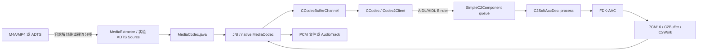

# 00 课程总览与源码索引

## 1. 目标与适用边界

本课程面向已有 C/C++、Audio HAL、AudioFlinger、ALSA/PCM 基础的工程师，以 **8 周、每周 8–10 小时** 为建议节奏。主线只覆盖 Android 多媒体音频，不展开蓝牙 HFP 的 CVSD/mSBC/LC3，也不把 Audio HAL 内置 Codec 与 MediaCodec 软件解码混为一谈。

完成后应能：

1. 区分 MP4/M4A 解封装、ADTS 封装、ASC/CSD 和 AAC 解码。
2. 从 App `queueInputBuffer()` 追踪到本树 `C2SoftAacDec::process()` 和 FDK-AAC。
3. 解释 `CCodec`、`CCodecBufferChannel`、`C2Component`、`C2Work`、`C2Buffer`、`SimpleC2Component` 的职责。
4. 验证 CSD、输出格式、PTS、Flush、Drain/EOS、Stop/Reset。
5. 在独立实验构建中添加可关闭日志、编译部署并分析数据连续性。
6. 区分软件 Codec2、厂商硬件 Codec、HAL 内部音频编解码路径。

## 2. 课程目录与实验清单

| 周 | 主题 | 核心实验 | 交付 |
|---|---|---|---|
| 1 | PCM/AAC/ADTS/ASC | PCM→AAC→PCM；C++ ADTS 解析；M4A 对比 | `01`、Native 解析器 |
| 2 | Extractor/MediaCodec | Android AAC→PCM；Codec 枚举；PCM 播放 | `02`、Android App |
| 3 | Java/JNI/Native | 逐层调用链；非法状态；持有输出 Buffer | `03`、状态/时序图 |
| 4 | CCodec/Codec2 | Work 构造、完成回调、成员对照 | `04`、Work 生命周期 |
| 5 | SimpleC2Component | 队列日志；5/15/30 ms 注入；Flush/Stop | `05`、线程图 |
| 6 | AAC/FDK 解码 | Fill/DecodeFrame trace；短包/坏 CSD/动态格式 | `06`、逐函数说明 |
| 7 | AAC 编码与异常 | PCM→AAC→PCM；Priming/Padding；错误矩阵 | `07`、测试矩阵 |
| 8 | 综合诊断 | 统一 Trace、基准、故障、真实组件证明 | `08`、最终报告 |

## 3. 源码版本快照

**源码根：** `Z:\work\DP8678GPU_GRP\android\system`。根目录本身不是 Git 工作树，版本按子仓库记录。

| 子仓库 | 分支/状态 | HEAD |
|---|---|---|
| `frameworks/base` | detached HEAD | `ee42aee9b1774e6c8cf8e19c9fd12946f93cb31b` |
| `frameworks/av` | `mtk8678_gpu_main_dev` | `8fa836e6a6f09d4f1d3fe4e72e68596d7fddd7b3` |
| `external/aac` | detached HEAD；远端分支名证据为 `origin/mtk8678_gpu_main_dev` | `c25fba6e77788e3ec2c2cba15bacbd0baab5b675` |

**版本结论：** 本树是 MTK 厂商 Gerrit 分支，不把这些提交标成 Android 14 或 Android 16。源码树存在 API 35 `android.jar`，只能证明该 API 桩存在，不能证明设备系统版本。整体 Android 版本、build fingerprint 和运行库是否由上述 HEAD 构建均为 **待设备核实**。

FDK 公开解码 API 宏为 3.2.0：`external/aac/libAACdec/include/aacdecoder_lib.h:434-436`。Git 命令因网络盘所有权触发 safe.directory 检查，未修改全局 Git 配置；扫描以实际文件和只读 HEAD 为证据，未声称工作树干净。

## 4. 源码映射表（推荐阅读顺序）

以下相对路径均从源码根开始，行号是当前工作树证据。

| 顺序 | 文件与关键入口 | 用途 |
|---|---|---|
| 1 | `frameworks/base/media/java/android/media/MediaCodec.java:2418,2778,3152,4278` | 公共 API、状态检查、输入/输出 |
| 2 | `frameworks/base/media/jni/android_media_MediaCodec.cpp:1818,2055,2122,3276` | JNI 参数转换与 Native 调用 |
| 3 | `frameworks/av/media/libstagefright/MediaCodec.cpp:2870,3570,3711,4544,6944` | Native 状态机、AMessage、BufferChannel |
| 4 | `frameworks/av/media/codec2/sfplugin/CCodec.cpp:1272,1342,2448,2770,3090` | C2 组件分配、控制、Work 完成 |
| 5 | `frameworks/av/media/codec2/sfplugin/CCodecBufferChannel.cpp:475,1024,2648` | Buffer 与 Work 转换、输出回送 |
| 6 | `frameworks/av/media/codec2/hal/client/client.cpp:3328,3457,3479` | 本树 `Codec2Client` 实现和 Binder 边界 |
| 7 | `frameworks/av/media/codec2/core/include/C2Component.h` | 组件接口、Listener、Store |
| 8 | `frameworks/av/media/codec2/core/include/C2Work.h` | `C2Work`、`C2Worklet`、输入/输出 ordinal |
| 9 | `frameworks/av/media/codec2/core/include/C2Buffer.h` | Linear/Graphic block、map、buffer 生命周期 |
| 10 | `.../components/base/SimpleC2Component.cpp:930,1085,1112,1293` | 工作队列、线程、Flush/Drain |
| 11 | `.../components/aac/C2SoftAacDec.cpp:337,374,613,1028` | AAC 适配层、FDK 调用、输出补偿 |
| 12 | `external/aac/libAACdec/src/aacdecoder_lib.cpp:1063,1149` | 公开 FDK API 包装、transport、错误映射 |
| 13 | `external/aac/libAACdec/src/aacdecoder.cpp:2481` | AAC 核心解码 |
| 14 | `.../components/aac/C2SoftAacEnc.cpp` | 编码器对照实验 |

**路径差异：** 任务书中的 `sfplugin/Codec2Client.cpp` 在本树不是实际实现位置；应读 `media/codec2/hal/client/client.cpp`，头文件为 `hal/client/include/codec2/hidl/client.h`。

## 5. 组件注册与构建证据

- `components/aac/Android.bp:20-35`：`libcodec2_soft_aacdec`，源文件含 `C2SoftAacDec.cpp`、`DrcPresModeWrap.cpp`，链接 `libFraunhoferAAC`。
- 同文件 `37-49`：`libcodec2_soft_aacenc`。
- `components/base/Android.bp:22-71`：`libcodec2_soft_common` 编译 `SimpleC2Component.cpp`。
- `external/aac/Android.bp:34-101`：`libFraunhoferAAC`。
- `C2SoftAacDec.cpp:57`：`c2.android.aac.decoder`；`1168-1208` 为工厂和导出入口。
- `media/codec2/vndk/C2Store.cpp:1196-1197`：平台动态库列表包含 AAC 解码/编码库；`1081-1131` 展示 `dlopen/dlsym/createFactory` 注册链。

因此“源码存在”不等于“设备正在使用”。最终必须用 `MediaCodecList`、组件日志/断点和运行库版本共同证明。

## 6. 整体架构



Codec2Client 存在 in-process 例外。控制调用常为“调用线程投递消息并等待”，数据处理为异步完成；不要把此图画成单线程同步栈。

## 7. 实验环境准备

### 主机

- 本次已有：Windows 11、PowerShell 7.6、Python 3.13、Java 22、ADB、Git。
- 本次缺少：CMake、C++ 编译器、FFmpeg/ffplay、Android SDK 环境变量、连接的 ADB 设备。
- 源码树可用于 Java 编译检查的桩：`prebuilts/sdk/35/public/android.jar`。
- Android APK 构建另需 JDK 17、Android SDK 35；Wrapper 已固定 Gradle 8.9、AGP 8.7.3。

```powershell
python --version
adb devices -l
ffmpeg -version
cmake --version
python -m unittest discover -s AudioCodecDebugger/tests -v
```

### 设备（待执行）

```sh
adb shell getprop ro.build.fingerprint
adb shell getprop ro.build.version.release
adb shell getprop ro.build.version.sdk
adb shell ps -A | grep -Ei 'media|codec|omx'
adb shell find /vendor/etc /system/etc -iname '*codec*.xml' 2>/dev/null
```

这些命令只辅助定位，不替代 `MediaCodecList`。不要假定所有版本都有同一 `dumpsys` 子命令，也不要只用 `lshal` 判断 Codec2 AIDL 服务。

### 编译与刷写风险

Native 实验只能在开发设备、独立分支进行。先保存原库和 build fingerprint，确认 AVB/动态分区/APEX 与重新签名要求；不要直接覆盖生产设备库。软件 AAC 组件可能位于 `com.android.media.swcodec` APEX，单独 push 系统分区中的同名文件不一定改变实际加载库。编译命令以项目环境的 `source build/envsetup.sh`、`lunch <已确认目标>`、`m libcodec2_soft_aacdec` 为起点，具体 lunch 目标和输出路径待本树确认。

## 8. 版本差异与未验证事项

| 事项 | 当前状态 |
|---|---|
| 整体 Android 版本 | 待 build fingerprint，不从版权年份推断 |
| Java/JNI/Native 行号 | 当前本地工作树已核实 |
| `MediaCodec::onStart()` | 本树无独立实现；启动在 `onMessageReceived(kWhatStart)` |
| `Codec2Client.cpp` 候选路径 | 本树应改为 `hal/client/client.cpp` |
| AIDL/HIDL | 客户端同时保留两种路径，运行时选择待设备日志 |
| MTK 扩展 | `MtkLogger`、自定义 C2 参数、视频 CSD/MBrain 等；不要归到上游 AOSP |
| 实际运行库与 HEAD 一致性 | 未验证 |
| APK/Native 构建、刷机、断点、5 分钟解码 | 未验证 |
| AOSP main 行为 | 仅辅助，不用于覆盖本地结论 |

## 9. 验证记录规则

每章结尾分别记录“已验证结论 / 技术推断 / 待设备验证”。示例数值使用 **[示例]**。时间测量必须写清单调时钟来源；PTS 是媒体时间，不可拿来算 CPU 耗时。输出指标至少拆分：

- `queueDelayNs = decodeStartNs - queueTimeNs`
- `decodeCostNs = decodeEndNs - decodeStartNs`
- `callbackLagNs = callbackTimeNs - decodeEndNs`
- App `outputWaitNs` 只表示 `dequeueOutputBuffer` 等待，不等于 `decodeCostNs`。

## 10. 参考资料

- 本地源码及上述提交为最高优先级。
- MediaCodec API：https://developer.android.com/reference/android/media/MediaCodec
- AOSP Codec2 辅助参考：https://android.googlesource.com/platform/frameworks/av/+/refs/heads/main/media/codec2/
- FDK-AAC 辅助参考：https://android.googlesource.com/platform/external/aac/
