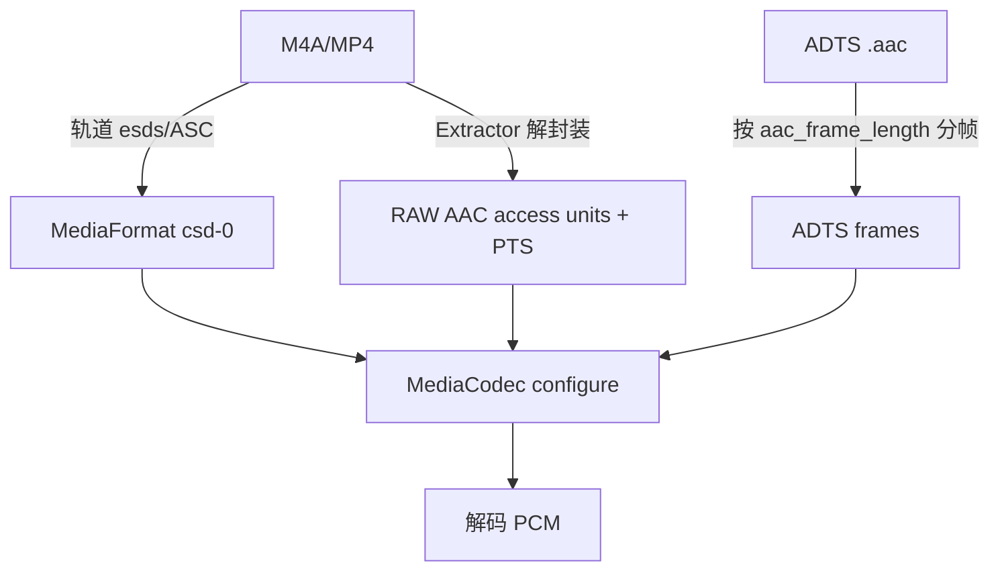
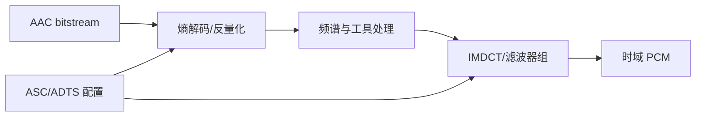

# 第 1 周：AAC 基础与码流

## 1. 本周学习目标与先决知识

目标：看到 `.aac`、`.m4a`、CSD 和 PCM 时，能明确每层数据是什么；能手工核算 PCM 大小和 AAC 帧时长；能运行并修改 ADTS 解析器，识别截断、坏 syncword、CRC 和 VBR。

先决知识：十六进制、位运算、C/C++ 基本 IO、采样率/声道/位深。无需推导 MDCT。

## 2. 关键概念：数据在哪一层

### PCM

本课程默认文件 PCM 为 **little-endian signed 16-bit、交错布局**。双声道一帧为 `L0 R0`，每帧 4 字节：

\[
bytes = framesPerChannel \times channels \times 2
\]

\[
durationSeconds = framesPerChannel / sampleRate
\]

48 kHz、16-bit、立体声、5 秒：`48000 × 5 × 2 × 2 = 960000` 字节。这里的“PCM 帧”是每声道一组样本，不要与 AAC access unit 混淆。

### AAC-LC 与帧长

AAC-LC 通常每个 access unit 每声道 1024 个样本，因此 48 kHz 时：

\[
1024 / 48000 \times 1{,}000{,}000 \approx 21333.333\ \mu s
\]

它不是“每个 `C2Work` 固定输出 4096 字节”的合同。`4096 = 1024 × 2 × 2` 只适用于典型 AAC-LC、48 kHz、双声道、PCM16 输出；SBR/PS、声道变化、延迟补偿、错误隐藏、合并输出和 drain 都可能改变观察结果。

压缩帧字节数在 VBR 下可不同。编码器会产生 priming/encoder delay，尾部可能 padding；M4A 的 edit list 等容器信息可描述有效媒体区间，不能只按 `AAC 帧数 × 1024` 断言最终样本数。

### ADTS 固定头

ADTS 是 AAC 裸流的传输封装，每帧自带同步和长度信息。解析时先检查 12-bit syncword `0xFFF`、2-bit layer 必须为 0，再读字段：

| 字段 | 工程意义 |
|---|---|
| `ID` | MPEG-4/MPEG-2 标识，不是 profile |
| `protection_absent` | 1 时头长 7；0 时有 CRC，头长 9 |
| `profile` | 2 bit，Audio Object Type = 字段值 + 1；1 通常对应 AAC-LC 字段值 |
| `sampling_frequency_index` | 查表，不能当采样率数值 |
| `channel_configuration` | 0 表示需从 PCE 获取，不能直接说“0 声道” |
| `aac_frame_length` | 13 bit，包含 ADTS 头、CRC（若有）和 payload |
| `number_of_raw_data_blocks_in_frame` | 字段值 + 1；时长要乘 raw data block 数 |

解析器只证明封装结构合理，不证明 Huffman/MDCT payload 可解码，也不校验 CRC 内容。

### ASC、CSD 与 M4A

ASC (`AudioSpecificConfig`) 描述 Audio Object Type、采样率索引、声道配置等。典型 AAC-LC、44.1 kHz、双声道 ASC 为 `12 10`；AAC-LC、48 kHz、双声道为 `11 90`（不含可选扩展的简化例）。

MediaCodec 的 `csd-0` 是 codec specific data 的载体；对 M4A AAC 通常承载 ASC。Extractor 从容器轨道取得它，Codec 用它初始化解码器。**M4A 样本通常不是逐样本带 ADTS 头**；不要给 M4A payload 再造 ADTS 头后交给同一路径。



## 3. 架构图：从压缩到声音的算法层次



工程重点是理解配置、访问单元、缓冲和输出，不在本周推导心理声学模型。FDK 的 `aacDecoder_Fill` 只填传输缓冲，`aacDecoder_DecodeFrame` 才驱动访问单元读取与核心解码。

## 4. 源码清单

| 顺序 | 文件/函数 | 读什么 |
|---|---|---|
| 1 | `AudioCodecDebugger/native/AacFrameParser/adts_parser.h`：`FrameInfo`、`parseAdts(...)` | 解析输出结构，不含猜测声道数 |
| 2 | `adts_parser.cpp`：`hasSync`、`skipId3v2`、`parseAdts` | sync、长度、CRC、截断检查 |
| 3 | `main.cpp`：`main(int,char**)` | 文本/CSV/JSON、退出码 |
| 4 | 本地 `frameworks/av/media/codec2/components/aac/C2SoftAacDec.cpp:678-725` | Android 适配层如何拆 ADTS 头 |
| 5 | `external/aac/libAACdec/include/aacdecoder_lib.h:795-849` | `CStreamInfo` 的 `frameSize/sampleRate/numChannels/outputDelay` |

**版本：** Native 实验为本交付新代码；Android 源码行号基于 `frameworks/av@8fa836e6` 当前工作树。

## 5. 源码逐函数解析

### `aac::parseAdts(const std::vector<uint8_t>&, bool recover)`

- **前置状态：** 输入是完整文件字节；默认 `recover=false`。
- **输出：** `ParseResult { frames, issues, ok }`，每帧保留 offset、长度、profile、采样率索引、channel configuration、raw blocks、CRC 和时长。
- **核心逻辑：** 可跳过合法 ID3v2；逐帧检查头和 `frameLength`；成功才推进到下一帧。保留 VBR 每帧长度。
- **异常路径：** 截断头、非法 sync/layer、保留采样率索引、头长超过帧长、声明帧长超过剩余字节均报错。`recover` 只扫描候选 sync，不保证 payload 正确。
- **线程：** 单线程，无全局可变状态。

### 本地 `C2SoftAacDec::process()` 的 ADTS 分支

`C2SoftAacDec.cpp:694-697` 用与实验相同的位组合取得 `aac_frame_length`；`699-705` 拒绝不完整帧；`707-716` 根据 `protectionAbsent` 选择 7/9 字节，随后只把 raw payload 填给 FDK。说明 **Codec2 AAC 适配层也承担 ADTS 封装处理**，不能将 Extractor 与 Codec 的职责简单画成所有格式都相同。

## 6. 关键调用链

```text
main → ifstream 读取文件 → parseAdts → hasSync/skipId3v2 → FrameInfo → text/CSV/JSON
```

这是主机同步调用，没有 Android 进程边界。设备链路对照：

```text
ADTS Source → MediaCodec input → C2SoftAacDec ADTS 分支 → FDK Fill/DecodeFrame
M4A Extractor → RAW access unit + csd-0 → C2SoftAacDec ConfigRaw/Fill/DecodeFrame
```

## 7. 可复现实验

### A. PCM→AAC→PCM

依赖 FFmpeg；本次主机未安装，因此命令未实测：

```powershell
python AudioCodecDebugger/scripts/generate_test_files.py --output AudioCodecDebugger/test_data --encode
ffprobe -show_streams -show_format AudioCodecDebugger/test_data/sine.m4a
```

脚本等价核心命令：

```sh
ffmpeg -f s16le -ar 48000 -ac 2 -i sine_48k_stereo_s16le.pcm -c:a aac -b:a 128k -f adts sine.aac
ffmpeg -f s16le -ar 48000 -ac 2 -i sine_48k_stereo_s16le.pcm -c:a aac -b:a 128k sine.m4a
ffmpeg -i sine.m4a -f s16le -acodec pcm_s16le decoded_ffmpeg_s16le.pcm
```

记录文件大小、时长、码率；不要预期解码 PCM 与原始 PCM bit-exact。

### B. C++ ADTS 解析器

```powershell
python AudioCodecDebugger/scripts/generate_test_files.py --output AudioCodecDebugger/test_data
cmake -S AudioCodecDebugger/native/AacFrameParser -B AudioCodecDebugger/native/AacFrameParser/build
cmake --build AudioCodecDebugger/native/AacFrameParser/build --config Release
# 将下列路径替换为实际生成程序路径
aac_frame_parser --json AudioCodecDebugger/test_data/parser_only_5_frames.adts
aac_frame_parser AudioCodecDebugger/test_data/truncated.adts
```

无编译器时先运行已实测的参考实现：

```powershell
python AudioCodecDebugger/scripts/adts_inspect.py AudioCodecDebugger/test_data/parser_only_5_frames.adts
```

**[示例] 预期：** 5 帧，每帧约 21333.333 μs；截断文件返回非零。合成 payload 只能测封装，不能送 AAC 解码器。

### C. ADTS 与 M4A 对比

对 FFmpeg 生成的同一 PCM 两种输出：

1. `ffprobe` 比较 format、stream、extradata/CSD。
2. ADTS 解析器列出帧长变化。
3. 用十六进制工具检查 M4A，不要在每个 sample 开头期待 `FFF` sync。
4. 后续用 Android App 分别解码，比较输入字节、输出 PCM、PTS。

## 8. 日志与问题定位

- 断点：`parseAdts` 的 `hasSync`、`frameLength` 计算、截断分支。
- 记录：文件 offset、声明长度、剩余长度、headerLength、rawDataBlocks。
- 每帧长度相同不是 AAC 必需性质；先确认编码模式再下结论。
- 解析器报“结构正常”但 Codec 失败：检查 payload、ASC/profile、SBR/PS 与 Codec 能力。
- 总时长偏差：检查编码延迟、尾部 padding、edit list，不要先修改采样率。
- `channel_configuration=0`：需 PCE 解析，本实验明确拒绝猜测。

## 9. 验收清单

- [ ] 独立计算 5 秒 48 kHz/双声道/PCM16 的字节数。
- [ ] 解释 `1024/48000≈21.333 ms` 及适用条件。
- [ ] 解析至少 100 个 VBR ADTS 帧并列出最短/最长帧。
- [ ] 识别 7 与 9 字节头，解释 CRC 字段。
- [ ] 对截断帧定位声明长度与剩余字节。
- [ ] 说明 M4A 的 Extractor 与 Codec 各自职责。
- [ ] 不把合成 ADTS payload 当成有效 AAC 音频。

## 10. 思考题（含答案）

**基础 1：所有 `.aac` 都是 ADTS 吗？** 不是。扩展名不是格式合同；可能是其他封装或误命名。应检查 sync/header/探测结果。

**基础 2：`csd-0` 是否等于完整 ADTS 头？** 不是。M4A AAC 常见 CSD 是 ASC；ADTS 头含传输同步和帧长，职责不同。

**基础 3：48 kHz、双声道、1024 samples 为什么典型输出 4096 bytes？** `1024 × 2 声道 × 2 字节`。这是 PCM16 典型例，不是 Work 固定大小。

**进阶 1：为什么 ADTS 解析成功仍可能解码失败？** 解析只检查外层字段和边界，payload 可能损坏、对象类型不受支持、CRC 错误或配置不一致。依据：本地解析器范围及 FDK 核心错误类型。

**进阶 2：为何不能由 AAC 帧数直接断言原始 PCM 样本数？** 编码延迟、尾部 padding、SBR 输出帧长和容器裁剪会改变有效样本范围。依据：FDK `outputDelay` 与 M4A 容器语义。

**进阶 3：一个 ADTS 帧一定只有 1024 samples/channel 吗？** 不一定。`number_of_raw_data_blocks_in_frame` 可含多个 raw block，且 AAC 工具/输出配置会改变观察到的 PCM 帧长；本解析器按时长乘 block 数。

## 11. 参考资料

- 本地 `C2SoftAacDec.cpp:678-742`、`aacdecoder_lib.h:795-849`。
- 本交付 `AudioCodecDebugger/native/AacFrameParser/` 与 `scripts/generate_test_files.py`。
- MediaCodec 格式文档：https://developer.android.com/reference/android/media/MediaFormat

## 12. 版本差异与未验证事项

- **已验证：** Python 参考解析器通过 5 帧、CRC、截断、坏 sync 自动化测试；实际素材已生成。
- **技术推断：** FFmpeg 输出具体码率/帧长取决于本机编码器版本，不预填数值。
- **待验证：** C++ 编译（本机无编译器）、FFmpeg 往返、真实设备 ADTS/RAW 输入行为。
- 本树 FDK API 为 3.2.0；不得把其他 FDK 版本的默认延迟或错误行为直接套用。
