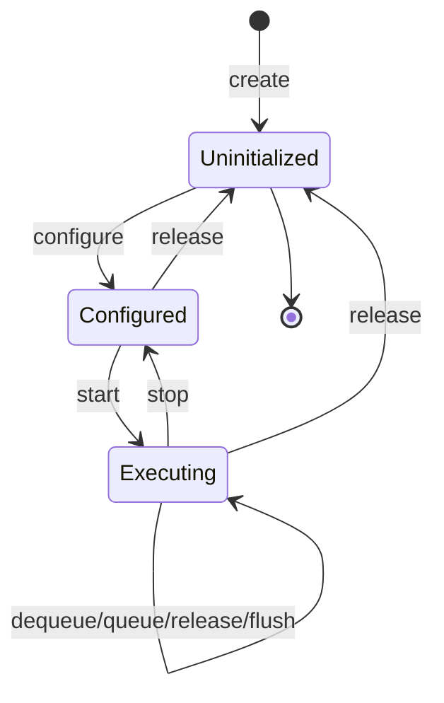
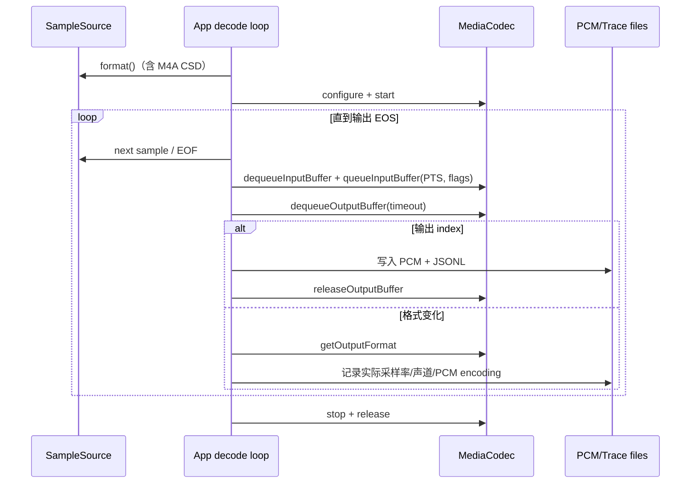

# 第 2 周：MediaExtractor 与 MediaCodec API

## 1. 本周学习目标与先决知识

目标：独立运行 AAC/M4A→PCM；正确选择轨道与 Codec、处理 CSD、PTS、输出格式变化、EOS 和 Buffer 所有权；枚举设备实际组件，而不是只看 XML。

先决知识：第 1 周格式基础、Java、Android 应用构建、ADB。示例使用同步 API，便于观察状态；异步回调在第 3 周对照。

## 2. 关键概念：API 合同与所有权

### Extractor 负责解封装

典型 M4A 流程：`setDataSource` → 遍历轨道 → `selectTrack` → `getTrackFormat` → 循环 `getSampleSize/readSampleData/getSampleTime/advance`。Track format 的 `csd-0` 随 `MediaCodec.configure` 传给解码器。Extractor 不产出 PCM。

本实验对 `.aac` 使用自定义 `AdtsSource`，因为裸 ADTS 不是 M4A 容器。它逐帧解析头和 PTS，不能用于任意 RAW AAC 文件。

### MediaCodec 状态与调用顺序



`flush()` 不是 `stop()`：它丢弃当前 Codec 缓冲并保持可继续输入的执行状态；EOS 是输入结束标记并请求输出 drain。具体异常以设备 API 为准。

### 输入 Buffer

`dequeueInputBuffer` 取得 index 后，通过 `getInputBuffer` 写入，再 `queueInputBuffer(index, offset, size, ptsUs, flags)` 转移所有权。排队后 App 不应再写该 Buffer。EOS 输入只提交一次，size 可为 0。

### 输出 Buffer

`dequeueOutputBuffer` 返回：

- `>=0`：有效 index，读取 `BufferInfo` 后必须 `releaseOutputBuffer`。
- `INFO_OUTPUT_FORMAT_CHANGED`：读取 `getOutputFormat`，更新 PCM 参数。
- `INFO_TRY_AGAIN_LATER`：无立即可用输出，不是错误。
- 其他负值按 API 处理，不臆造输出。

同步音频解码中 `releaseOutputBuffer(index, false)` 不渲染到 Surface。持有不释放会减少可用缓冲并可能形成反压。

### PTS 与执行时间

`presentationTimeUs` 属于媒体时间轴；`System.nanoTime()` 属于进程内单调执行时钟。二者不可相减。本实验的 `outputWaitNs` 只是 App  dequeue 等待，不是 FDK 解码 CPU 时间。

## 3. 架构图：同步解码循环



输入与输出交错处理，避免只灌输入造成反压；输入数与输出数不要预设相等。

## 4. 源码清单

| 顺序 | 文件 | 关键结构/函数 |
|---|---|---|
| 1 | `AudioCodecDebugger/android/.../AacDecoder.java` | `decode(...)`、`ExtractorSource`、`AdtsSource` |
| 2 | 同目录 `CodecEnumerator.java` | `MediaCodecList.ALL_CODECS`、AAC 能力 |
| 3 | 同目录 `TraceLogger.java` | JSONL、PID/TID、单调时间 |
| 4 | `frameworks/base/media/java/android/media/MediaCodec.java:2778,2834,3152,4278` | start/flush/queue/dequeue 公共入口 |
| 5 | 本地 `C2SoftAacDec.cpp:649-668` | CSD 经 `aacDecoder_ConfigRaw` 配置 |

完整路径以 `00_课程总览与源码索引.md` 为准。App 源文件位于 `app/src/main/java/com/example/audiocodecdebugger/`。

## 5. 源码逐函数解析

### `AacDecoder.decode(...)`

- **前置状态：** 输入路径存在；M4A 内含 `audio/mp4a-latm`，或 `.aac` 为本实验支持的 ADTS；输出为 app 专属目录。
- **参数：** 输入、PCM、Trace、可选 Codec 名；实验重载允许 `flushAfterInputs`，默认 -1 不注入。
- **核心逻辑：** 选择 Source → 创建并配置 Codec → start → 输入/输出循环 → 输出 EOS → stop/release。
- **输出：** PCM16 文件和 JSONL；`Result` 返回输入/输出计数、释放计数、实际格式。
- **异常路径：** 无 AAC track、输入容量不足、截断 ADTS、非 PCM16、CodecException、120 秒无进展。
- **线程：** App 单后台执行器；Codec 内部有独立 looper/Binder/组件线程。

### `ExtractorSource.next/write/onQueued`

`next` 只查询 sample 大小与 PTS；`write` 调 `readSampleData` 并核对实际字节数；排队成功后才 `advance`。若容量不足先报错，避免样本被截断后仍排队。

### `AdtsSource.readFrame`

读取 7 字节固定头，按 `protection_absent` 和 `aac_frame_length` 读完剩余字节；依据采样率/raw blocks 生成合成 PTS。它不支持 `channel_configuration=0` 的 PCE，遇到时明确失败。

### `CodecEnumerator.enumerateAac`

同时列出 `isSoftwareOnly()`、`isHardwareAccelerated()`、`isVendor()`、`isAlias()` 和支持能力。**[API 合同]** 属性来自设备公布信息；要证明运行中进入某实现仍需 trace/断点。

## 6. 关键调用链

```text
MainActivity.execute(action)
  → executor.execute
  → AacDecoder.decode
      → ExtractorSource / AdtsSource
      → MediaCodec.createByCodecName("c2.android.aac.decoder")
      → configure(format with csd-0) → start
      → queueInputBuffer ↔ dequeueOutputBuffer/releaseOutputBuffer
      → FileChannel.write(PCM) + TraceLogger.event
      → stop → release
```

App 调用与底层完成不是同一同步栈。第 3–6 周继续跟踪 Native。

## 7. 可复现实验

### A/B. 构建、枚举与解码

环境：JDK 17、Android SDK 35、ADB 开发设备。详细风险与 push/pull 命令见 `AudioCodecDebugger/android/README.md`。

```powershell
cd AudioCodecDebugger/android
.\gradlew.bat assembleDebug
adb install -r app/build/outputs/apk/debug/app-debug.apk
adb shell am start -n com.example.audiocodecdebugger/.MainActivity --es action enumerate
adb shell am start -n com.example.audiocodecdebugger/.MainActivity --es action decode_m4a
adb logcat -s AudioCodecDebugger:I C2SoftAacDec:V
```

输入：`files/input/input.m4a`；输出：`files/output/decoded_m4a_s16le.pcm` 和 `.jsonl`。预期出现 `started`、多个 `input/output`、可能的 `format_changed`、`input_eos/finished`，且 `outputCount == outputReleasedCount`。

### C. PCM 验证

```powershell
adb pull /sdcard/Android/data/com.example.audiocodecdebugger/files/output AudioCodecDebugger/device_output
ffplay -f s16le -ar 48000 -ac 2 AudioCodecDebugger/device_output/decoded_m4a_s16le.pcm
python AudioCodecDebugger/scripts/compare_pcm.py original.pcm AudioCodecDebugger/device_output/decoded_m4a_s16le.pcm --sample-rate 48000 --channels 2 --scan-delay 4096
```

采样率/声道按 `format_changed` 调整。AAC 有损，SNR/波形/样本数比 bit-exact 更有意义。

### 5 分钟稳定性

用 FFmpeg 生成至少 5 分钟输入，执行解码并检查：

1. 每个输出 index 都释放，无 120 秒 stall。
2. JSONL 无异常 PTS 大倒退（允许 flush 实验的明确不连续）。
3. PCM 字节数能被 `channels × 2` 整除。
4. `stop/release` 无 `IllegalStateException` 或 native crash。
5. 重复 3 次，比较输出字节数与错误计数。

本次无设备，不能声称通过。

## 8. 日志与问题定位

- `createByCodecName` 失败：先枚举；可能设备库名不同或组件未发布。
- `configure` 失败：打印 MediaFormat、CSD 长度/十六进制、profile、采样率和声道。
- 只有输入没有输出：确认 EOS、输出循环和 Buffer 释放；AAC 可能有输出延迟。
- 输出爆音：检查是否把容器/ADTS 头写进 PCM，及 s16le/交错参数。
- 时长偏差：区分容器有效区间、priming/padding、输出延迟。
- 连续 PTS 不等距：先检查源容器，再检查 Work 合并与格式变化，不强制 21.333 ms。
- App 层无法测 Native decode cost：使用第 5/6 周补丁。

## 9. 验收清单

- [ ] 枚举 `audio/mp4a-latm` 并记录实际选择名称和软件/厂商属性。
- [ ] M4A 与 ADTS 分别解码，解释 CSD 输入差异。
- [ ] 输出 EOS 后退出，且输出获取数与释放数一致。
- [ ] 正确处理至少一次输出格式通知。
- [ ] 连续解码 5 分钟无 Buffer 泄露/停顿。
- [ ] 用 PCM 工具验证实际采样率、声道、位深和长度。
- [ ] 能说明输入与输出 Buffer 所有权何时转移。

## 10. 思考题（含答案）

**基础 1：为什么 M4A 样本不能直接按 ADTS 解析？** M4A 是容器，Extractor 给出 RAW AAC access unit 与独立 CSD；通常没有逐样本 ADTS 头。

**基础 2：`INFO_TRY_AGAIN_LATER` 是错误吗？** 不是，是当前无可用结果。持续很久才需排查反压、EOS 或组件故障。

**基础 3：为什么必须处理 `INFO_OUTPUT_FORMAT_CHANGED`？** 实际采样率、声道、PCM encoding 可能与初始假设不同，PCM 文件没有头，错误参数会直接造成播放异常。

**进阶 1：输入 100 个 Buffer 是否必得 100 个非空输出？** 不保证。CSD、内部缓存、输出延迟、合并、错误和 EOS drain 都会改变对应关系。

**进阶 2：为什么输出 Buffer 不释放会反压输入？** 缓冲池资源有限，持有输出使组件/上层无法复用内存，最终输入和输出调度都可能停顿；具体阈值依实现。

**进阶 3：`flush()` 后应重新 `configure()` 吗？** 通常不需要；flush 丢弃执行中的缓冲并保持配置。但 Source 的位置/PTS 连续性由 App 负责，且必须遵守当前 API 状态。

## 11. 参考资料

- MediaCodec API：https://developer.android.com/reference/android/media/MediaCodec
- MediaExtractor API：https://developer.android.com/reference/android/media/MediaExtractor
- MediaCodecList API：https://developer.android.com/reference/android/media/MediaCodecList
- 本地 `MediaCodec.java` 与本交付 Android 完整源码。

## 12. 版本差异与未验证事项

- **已验证：** 全部 Java 源码使用本地 API 35 `android.jar` 编译通过。
- **API 合同：** 状态与 Buffer 语义按公共文档；设备异常文本不作固定断言。
- **待验证：** APK assemble、设备安装、实际软件组件选择、M4A/ADTS 解码、5 分钟稳定性、PCM 听感。
- 本树是 MTK 厂商分支；其他 Android 14/16 设备的组件名、AIDL/HIDL 和输出格式字段可能不同。
