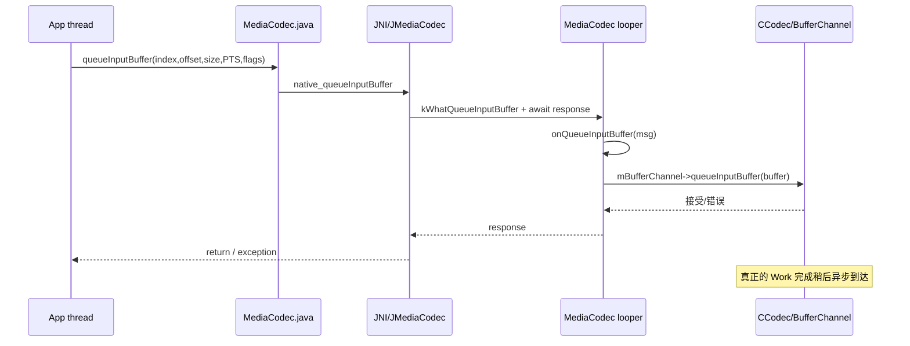

# 第 3 周：MediaCodec Java / JNI / Native 源码解析

## 1. 本周学习目标与先决知识

目标：以本地 MTK 源码为准，把 `configure/start/queueInputBuffer/dequeueOutputBuffer/flush/stop` 从 Java 追到 Native；解释 `AMessage/ALooper/AHandler` 的线程切换与同步等待；识别状态错误和输出 Buffer 反压。

先决知识：第 2 周 API、JNI、C++ `sp`、基础消息循环。所有行号对应当前工作树，不能复制到其他分支后直接使用。

## 2. 关键概念：三个层次，不等于三个线程

- **Java：** 公共状态检查、异常、同步/异步 API、Java 回调。
- **JNI：** Java 对象、数组、`MediaFormat` 与 Native 对象之间的转换；`JMediaCodec` 持有 Native `MediaCodec`。
- **Native MediaCodec：** 状态机、消息处理、输入/输出 Buffer 池与 `MediaCodecBufferChannel`。
- **CCodec：** 是 Native MediaCodec 的 Codec2 后端，不是 JNI 的一部分。

`PostAndAwaitResponse` 表示“消息在 looper 线程执行，调用线程等待答复”，所以它是**异步消息执行 + 同步等待结果**。它不意味着底层 AAC 解码在调用栈内同步完成。

本树 JNI 创建 `MediaCodec_looper`（`android_media_MediaCodec.cpp:251-268`）。Native 音频通常复用 `mLooper`，视频另建 `CodecLooper`（`MediaCodec.cpp:2603-2618`）。CCodec 又有自己的消息处理，Codec2 服务可能跨 Binder。

## 3. 架构图：控制流与数据流分开



## 4. 源码清单（按阅读顺序）

| 顺序 | 文件：行 | 函数/结构 |
|---|---|---|
| 1 | `frameworks/base/media/java/android/media/MediaCodec.java:2418,2460` | public/private `configure` |
| 2 | `.../android_media_MediaCodec.cpp:1818,398` | JNI configure → `JMediaCodec::configure` |
| 3 | `frameworks/av/media/libstagefright/MediaCodec.cpp:2870` | `MediaCodec::configure(...)` |
| 4 | `MediaCodec.cpp:4544,5529` | `onMessageReceived` / `kWhatConfigure` |
| 5 | `MediaCodec.java:3152`；JNI `:2122`；Native `:3711,6944` | 输入完整链 |
| 6 | `MediaCodec.java:4278`；JNI `:3276`；Native `:3979,6195` | 输出 dequeue |
| 7 | `MediaCodec.cpp:4269,6365`；`CCodec.cpp:2770,2797` | Flush |
| 8 | `MediaCodec.cpp:3628,5900`；`CCodec.cpp:2543,2573` | Stop |
| 9 | `frameworks/av/media/libstagefright/MediaCodecList.cpp` | 组件发现补充 |

关键结构：`AMessage` 保存 what 与参数，`ALooper` 分发，`AHandler` 处理，`sp<MediaCodecBuffer>` 承载 Native Buffer 元数据。

## 5. 源码逐函数解析

### configure

真实 Native 签名（`MediaCodec.cpp:2870`）：

```cpp
status_t MediaCodec::configure(const sp<AMessage>&, const sp<Surface>&,
        const sp<ICrypto>&, const sp<IDescrambler>&, uint32_t flags)
```

Java `configure` 汇聚到私有实现并调用 `native_configure`；JNI 在 `1818` 进入，`JMediaCodec::configure` 于 `398` 调 Native。Native `2892` 创建 `kWhatConfigure`，`2944` 等待响应；消息分支 `5529` 最终于 `5735` 调 `mCodec->initiateConfigureComponent(format)`。

- **前置：** Uninitialized、格式有效。
- **线程：** App→JNI→MediaCodec looper→CCodec 消息。
- **异常：** 参数转换、状态、组件分配/配置失败经 response 返回，再映射 Java 异常。
- **输出：** Configured 状态或错误，不是已解码 PCM。

### start

Java `start()`：`MediaCodec.java:2778`；JNI `:2055`；Native `MediaCodec::start()`：`3570`。Native `3620` 等待 `kWhatStart`，消息分支 `5859`，`5896` 调 `mCodec->initiateStart()`。CCodec `start()` 在 `2464`，`2478` 调组件 `start`，`2509` 启动 channel，`2538` 完成状态，`2540` 请求首批输入。

**版本差异：** 本树没有独立 `MediaCodec::onStart()`；不要为匹配旧教程捏造它。

### queueInputBuffer

真实 Native 签名（`MediaCodec.cpp:3711`）：

```cpp
status_t MediaCodec::queueInputBuffer(size_t index, size_t offset,
        size_t size, int64_t presentationTimeUs, uint32_t flags,
        AString *errorDetailMsg)
```

`3730` 创建消息，`3738` 等答复；`6165` 进入分支，`6188` 调 `onQueueInputBuffer`。其定义于 `6944`，普通未加密路径在 `7266` 调 `mBufferChannel->queueInputBuffer(buffer)`。

观察项：index、offset、size、PTS、flags、Crypto/Drm 分支、Buffer 状态。MTK 自定义 `BUFFER_FLAG_INVLIDPTS` 在 `7057-7059` 转为 `invt`，属于本地扩展。

### dequeueOutputBuffer

Java `4278` → JNI `3276` → Native `3979`。Native 投递 `kWhatDequeueOutputBuffer` 并等待；消息分支 `6195` 禁止异步模式误用，`6206-6207` 调处理函数。无可用输出时保存 pending reply，`6224-6229` 设置超时。

它不会让 HAL 同步“拉一帧”：HAL 已完成输出先通过 CCodec 队列送回，dequeue 只消费上层可用结果或等待。

### flush / stop

- `MediaCodec::flush()`：`4269`；消息 `6365`；`6389` 调 `CCodec::signalFlush()`。
- CCodec `signalFlush`：`2770`，停止 channel 后发 `kWhatFlush`；`flush()`：`2797`，`2812` 调组件 flush，`2822` 把 flushed work 交回 channel。
- `MediaCodec::stop()`：`3628`；`6083-6084` 进入 `initiateShutdown(true)`；CCodec `stop`：`2573`，实际组件 stop 在 `2610/2614`。

前置状态不同，不能互换。Stop 后需按 API 重新 start；release 后对象不可复用。

## 6. 关键调用链汇总

| API | 调用者→被调用者 | 边界 |
|---|---|---|
| configure | Java→JNI→Native msg→CCodec msg | 控制调用等待响应 |
| start | Java→JNI→Native msg→CCodec→Component | 启动 BufferChannel |
| input | Java→JNI→Native msg→BufferChannel | Work 处理后续异步 |
| output | HAL listener→CCodec work queue→BufferChannel→MediaCodec | 完成先异步上报 |
| dequeue | Java→JNI→Native pending reply | 可超时，不反向同步解码 |
| flush | Java→JNI→Native→CCodec→Component | 丢弃 Work，见第 5 周 |
| stop | Java→JNI→Native→CCodec shutdown | 生命周期控制 |

## 7. 可复现实验

### A. 调用链证据表

在第 2 周 App 的 `queueInputBuffer` 断点起步，按上表逐函数设置断点。每次记录：线程名/TID、当前状态、index/offset/size/PTS/flags、函数返回。若只使用 App 无法 attach framework，可先用源码阅读和 `MediaCodec` 日志，最终 Native 断点留待 eng/userdebug 设备。

### B. 非法状态矩阵

运行 `CodecFaultTest` 的 `start_before_configure` 与 `configured_start_stop_without_input`，再扩展：

| 操作 | 预期类别 | 记录 |
|---|---|---|
| configure 前 start | `IllegalStateException` | 实际消息/堆栈 |
| stop 后继续 queue | 状态错误 | 不吞异常 |
| release 后操作 | 状态错误 | 不重复 release |
| Executing 中 flush | 接受 | 后续输入是否继续 |
| 重复 EOS | 协议错误/未定义风险 | 实验代码避免重复 |

### C. 持有输出 Buffer

`CodecFaultTest` 对 M4A 持有前 4 个输出 index，观察 `INFO_TRY_AGAIN_LATER`，随后释放。4 不是通用池大小；无反压也可能是池更大或实现排队不同。实验有 120 秒超时和 finally 释放，不在生产代码使用。

## 8. 日志与问题定位

- 首选断点：Native `onQueueInputBuffer`、BufferChannel 入口、CCodec `onWorkDone`。
- 线程证据：打印 TID/looper 名，不仅看调用栈。
- 卡在 `PostAndAwaitResponse`：找对应消息是否执行、response 是否丢失、对端是否死亡。
- dequeue 超时：区分“没有新输出”和“完成回调未到”；检查 CCodec work queue。
- 状态异常：先还原最近 configure/start/stop/flush/release 顺序。
- MTK 日志与上游不同：包含 `MtkLogger`，不要删掉厂商日志当 AOSP 行为。

## 9. 验收清单

- [ ] 独立写出 queueInputBuffer 的 Java/JNI/Native 签名与行号。
- [ ] 指出 `kWhatQueueInputBuffer` 的执行线程。
- [ ] 解释为什么 API 等待响应不等于 FDK 同步解码。
- [ ] 画出 HAL 完成到 dequeue 的两段异步链。
- [ ] 记录至少 3 种非法状态的实际异常。
- [ ] 持有输出 Buffer 后能恢复释放并解释观察值。
- [ ] 明确本树没有独立 `MediaCodec::onStart()`。

## 10. 思考题（含答案）

**基础 1：JNI 是否执行 AAC 算法？** 否。JNI 做对象/参数转换并进入 Native MediaCodec，算法在后续组件/FDK。

**基础 2：`AMessage` 与 PTS 有何关系？** `AMessage` 可携带 PTS 参数，但它是框架消息，不是媒体时间本身，也不提供单调执行时钟。

**基础 3：dequeue 返回超时是否说明 Codec 崩溃？** 不必然。可能只是无输出、输入不足、反压或正常延迟，需结合输入/EOS/完成回调。

**进阶 1：为什么输出完成先于 App dequeue？** 组件异步完成并把 Buffer 放入上层可用集合；App dequeue 是消费可用结果，不是触发解码。

**进阶 2：为什么 `flush` 要同时处理组件和 BufferChannel？** 组件中可能有 queued/pending work，上层 channel 也持有输入/输出与回调状态，只清一层会泄露旧 Work 或旧 PTS。

**进阶 3：本树能否直接套 AOSP main 行号？** 不能。厂商提交、MTK 扩展和版本演进均改变行号与实现；当前证据固定到本地 HEAD/工作树。

## 11. 参考资料

- 本地 `frameworks/base@ee42aee9`、`frameworks/av@8fa836e6` 上述文件。
- `foundation/AMessage.cpp`、`ALooper.cpp`、`AHandler.cpp`（建议继续阅读；具体行号未在本次索引中核实）。
- Android MediaCodec API 官方文档。

## 12. 版本差异与未验证事项

- **已验证：** 路径、函数、消息分支和行号来自本地扫描。
- **技术推断：** 调用等待与异步完成边界由消息代码得出，尚未 attach 设备验证时序。
- **待验证：** Native 断点、实际 looper/TID、厂商设备错误文本、输出反压阈值。
- `CCodec.cpp`、`MediaCodec.cpp` 含 MTK 日志；AIDL/HIDL 分支和厂商定制不应归到所有 AOSP 版本。
