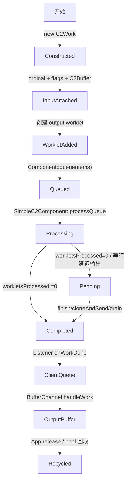

# 第 4 周：CCodec 与 Codec2 核心对象

## 1. 本周学习目标与先决知识

目标：掌握 CCodec 控制面与 BufferChannel 数据面分工；跟踪 MediaCodecBuffer→C2Work→C2Component→C2Work 完成→MediaCodec 输出；理解 frameIndex、PTS、flags、result 与 Buffer 所有权。

先决知识：第 3 周消息机制、C++ 智能指针、`unique_ptr` 所有权、Binder 基础。

## 2. 关键概念：对象职责

| 对象 | 工程职责 | 不应误解为 |
|---|---|---|
| `CCodec` | 组件分配、配置、start/stop/flush/release、Listener、Work 完成排队 | AAC 算法实现 |
| `CCodecBufferChannel` | MediaCodecBuffer 与 C2 Buffer/Work 转换、输入/输出池与回调 | 简单字节队列 |
| `Codec2Client` | Store/Component 的 AIDL/HIDL 客户端与 Binder 转换 | 所有实现都跨进程 |
| `C2ComponentInterface` | 参数、名称、domain/kind 等接口配置 | 执行 Work 的线程 |
| `C2Component` | start/queue/flush/drain/stop 等执行接口 | 具体软件解码器 |
| `C2Work` | 一次组件工作提交：输入、worklets、处理计数、result | 固定一个 AAC 帧 |
| `C2Worklet` | 一组输出及输出 ordinal/configUpdate | 必然只有一个 PCM Buffer |
| `C2Buffer` | 对 linear/graphic block 的只读组合视图 | 原始 `byte[]` |
| `C2BlockPool` | 输出块分配/复用 | 无限制的内存池 |
| `SimpleC2Component` | 软件组件队列、线程、pending work、生命周期基类 | BufferChannel 的替代品 |

一个 Work 可含配置数据、多个输入块或 EOS；AAC 组件内部可缓存，输出可延迟或通过 pending/clone 完成。

## 3. 架构图：Work 生命周期



Flush/Stop 可从 queued/pending 分支到 cancelled/flushed，result 可能是 `C2_NOT_FOUND` 或组件定义结果，不能当成正常 PCM。

## 4. 源码清单

| 顺序 | 本地文件：行 | 重点 |
|---|---|---|
| 1 | `media/codec2/core/include/C2Work.h:218-245` | `C2Work` 成员 |
| 2 | `.../C2Component.h:337,442,584,612,806` | Listener、queue、生命周期、Store |
| 3 | `.../C2Buffer.h:1247,1286,2167` | map、C2Buffer |
| 4 | `sfplugin/CCodec.cpp:1272,1342,2448,2770,3090` | 控制与 Listener |
| 5 | `sfplugin/CCodecBufferChannel.cpp:475,1024,2648` | Work 构造和输出 |
| 6 | `hal/client/client.cpp:1245,1342,3328,3364` | AIDL/HIDL Work/Flush |
| 7 | `hal/client/client.cpp:2633,2857,2931` | 服务发现、创建、列表 |
| 8 | `components/base/SimpleC2Component.cpp` | 下一周具体实现 |

## 5. 源码逐函数解析

### `CCodec::allocate`

`CCodec.cpp:1272`：`1285` 创建默认 `Codec2Client`，`1293-1297` 按名称创建组件，`1308` 将组件设置给 channel。

- **前置：** MediaCodec 已按名称选择 CCodec 后端。
- **输出：** 客户端组件代理与 BufferChannel 关联。
- **异常：** 服务发现、创建、接口不兼容。
- **进程：** 客户端在 media 进程，实际组件普通路径经 Binder；`__ApexCodecs__` 是本树明确 in-process 例外。

### `CCodecBufferChannel::queueInputBufferInternal`

真实签名（`CCodecBufferChannel.cpp:475`）：

```cpp
status_t CCodecBufferChannel::queueInputBufferInternal(
        sp<MediaCodecBuffer> buffer,
        std::shared_ptr<C2LinearBlock> encryptedBlock,
        size_t blockSize)
```

调用者 `queueInputBuffer` 在 `1024`，`1030` 进入内部实现。关键步骤：

1. `521-524` 创建 Work，设置 `timestamp/frameIndex`。
2. `599` 把输入转换为 `C2Buffer` 并附加。
3. `643-649` 本地 MTK 视频参数注入；AAC 不应误用该视频语义。
4. `652-655` 创建 `C2Worklet` 并形成 work list。
5. `687` 调 `mComponent->queue(&items)`。

**返回：** 接受/错误，不是 AAC 解码完成。输入 Block 的 map 生命周期由 C2 对象管理，不能保留临时 ReadView 指针。

### `Codec2Client::Component::queue`

`client.cpp:3328`；AIDL 转换后 Binder 在 `3343`，HIDL 在 `3351`。这一层是代理和协议转换，真正的 `SimpleC2Component::queue_nb` 在组件端。

### Work 完成

1. HIDL `HidlListener::onWorkDone`：`1245`；AIDL 对应 `1342`。
2. `CCodec::ClientListener::onWorkDone`：`CCodec.cpp:1113`，`1122` 进入 CCodec。
3. `CCodec::onWorkDone`：`3090`，放 `mWorkDoneQueue`，`3098` 投消息。
4. 消息分支 `3177`，`3302` 调 channel `onWorkDone`。
5. `CCodecBufferChannel::onWorkDone`：`2648`，`2681` 调 `handleWork`。
6. `handleWork` 检查结果/格式/Buffer，`3062` 发输出，`3140` 回调上层。

`C2Component::Listener::onWorkDone_nb` 是抽象回调，不应在抽象接口随意断点并期待算法栈；应定位上述实际 Listener。

## 6. C2Work 成员对照与调用链

| 观察项 | 所在层 | 含义 |
|---|---|---|
| `input.ordinal.frameIndex` | C2Work 输入 | 内部工作序号，不是 PTS |
| `input.ordinal.timestamp` | C2Work 输入 | 媒体时间，通常 μs 语义由上层建立 |
| `input.flags` | C2FrameData | CSD/EOS 等输入标记 |
| `input.buffers` | C2FrameData | 输入 C2Buffer 列表 |
| `input.configUpdate` | C2FrameData | 输入配置更新 |
| `worklets` | C2Work | 输出工作单元列表 |
| `workletsProcessed` | C2Work | 已处理 worklet 数，影响 pending/完成 |
| `worklets[i].output` | C2Worklet | 输出 Buffer、flags、ordinal、configUpdate |
| `result` | C2Work | 组件处理状态，需与输出是否存在一起判断 |

```text
MediaCodecBuffer
 → queueInputBufferInternal
 → C2Work{input + worklet}
 → Codec2Client::Component::queue
 → Binder / in-process 例外
 → C2Component::queue_nb 实现
 → Listener::onWorkDone_nb
 → CCodec mWorkDoneQueue
 → CCodecBufferChannel::handleWork
 → MediaCodecCallback::onOutputBufferAvailable
```

## 7. 可复现实验

### A. Work 构造断点表

在 `queueInputBufferInternal` 创建 Work、附 Buffer、创建 Worklet、queue 前设置断点。记录：

- `frameIndex/timestamp/flags`
- 输入 buffer 数、首块容量/offset
- `blockSize`
- worklet 数
- queue 返回码

加密输入与普通输入分开，不把 `encryptedBlock` 当 PCM/AAC 明文。

### B. 统一 Trace

应用 `patches/0001-aac-codec2-trace.patch` 的实验版本（见 patches README，先 `git apply --check`）。建议字段：

```cpp
struct CodecTrace {
    uint64_t frameIndex;
    int64_t ptsUs;
    size_t inputBytes;
    size_t outputBytes;
    int64_t queueTimeNs;
    int64_t decodeStartNs;
    int64_t decodeEndNs;
    int64_t callbackTimeNs;
    int32_t result;
};
```

原始补丁采用便于 logcat 的 key=value；生产默认关闭。需要 CSV/JSONL 时由采集脚本转换，不用 PTS 计算耗时。

### C. 完成回调验证

从组件 `onWorkDone_nb` 跟到 `handleWork`，对同一 frameIndex 比较 result、输出 Buffer 数、输出 PTS 和 flags。若无法一一匹配，记录 pending/clone/drain，而不是强行配对。

## 8. 日志与问题定位

- Work 未提交：检查组件状态、queue 返回、Binder death。
- Work 已提交无完成：检查 `processQueue`、pending map、输出 pool、drain。
- frameIndex 不连续：Flush 丢弃、取消或过滤可能发生；检查 generation。
- PTS 不连续：区分源数据、上层 ordinal、输出补偿和应用释放。
- result 非 OK 但有输出：AAC concealment/静音等实现可能仍产出 Buffer，需按本树判断。
- 崩溃于 LinearBlock map：检查 block 类型、map RAII 生命周期和跨进程只读范围。

## 9. 验收清单

- [ ] 画出 C2Work 从构造到回收的完整生命周期。
- [ ] 解释 CCodec 与 BufferChannel 的控制/数据分工。
- [ ] 找到本树真正的 `Codec2Client` 实现文件。
- [ ] 说明 frameIndex 与 timestamp 不能互相替代。
- [ ] 跟踪一次 `onWorkDone` 到 MediaCodec 输出回调。
- [ ] 解释 `workletsProcessed=0` 为什么可能进入 pending。
- [ ] 识别一个 in-process 例外，不绝对化 Binder 边界。

## 10. 思考题（含答案）

**基础 1：C2Work 是压缩 AAC 帧吗？** 不是，它是工作容器，输入可含 AAC、CSD、EOS 或其他块。

**基础 2：C2Buffer 是否就是 Java ByteBuffer？** 不是。Java Buffer 经多层转换，C2Buffer 是 C2 block 的组合视图，有独立所有权和 map 规则。

**基础 3：result=C2_OK 是否必有非空 PCM？** 否。配置、缓存、延迟或 drain 阶段都可能暂无 PCM。

**进阶 1：为什么完成回调先进入 CCodec 队列再 handleWork？** 将 Binder/Listener 上下文与 CCodec 状态处理解耦，避免在回调线程直接执行复杂 Buffer/状态逻辑。

**进阶 2：frameIndex 可用于计算 decode CPU 时间吗？** 不能。它只标识工作序，计算需同一单调时钟的 start/end。

**进阶 3：为何不能仅凭服务列表证明进入软件 AAC？** 组件可注册但未选择，也可能有同名/别名或硬件优先；需 MediaCodecList 实际名称与运行 trace 共同证明。

## 11. 参考资料

- 本地 `C2Component.h`、`C2Work.h`、`C2Buffer.h`。
- 本地 `CCodec.cpp`、`CCodecBufferChannel.cpp`、`hal/client/client.cpp`。
- AOSP Codec2 目录仅作辅助：https://android.googlesource.com/platform/frameworks/av/+/refs/heads/main/media/codec2/

## 12. 版本差异与未验证事项

- **已验证：** 本地函数、成员位置、AIDL/HIDL 客户端和 MTK 参数扩展。
- **技术推断：** Work 生命周期图概括多条源码路径，不表示每次必经所有节点。
- **待验证：** 实际 Binder/in-process 选择、字段日志、输出 pool 行为、同一 Work 的完成次数。
- 本树 `queueInputBufferInternal` 含 MTK 视频 CSD/MBrain 逻辑；分析 AAC 时应隔离这些非通用分支。
