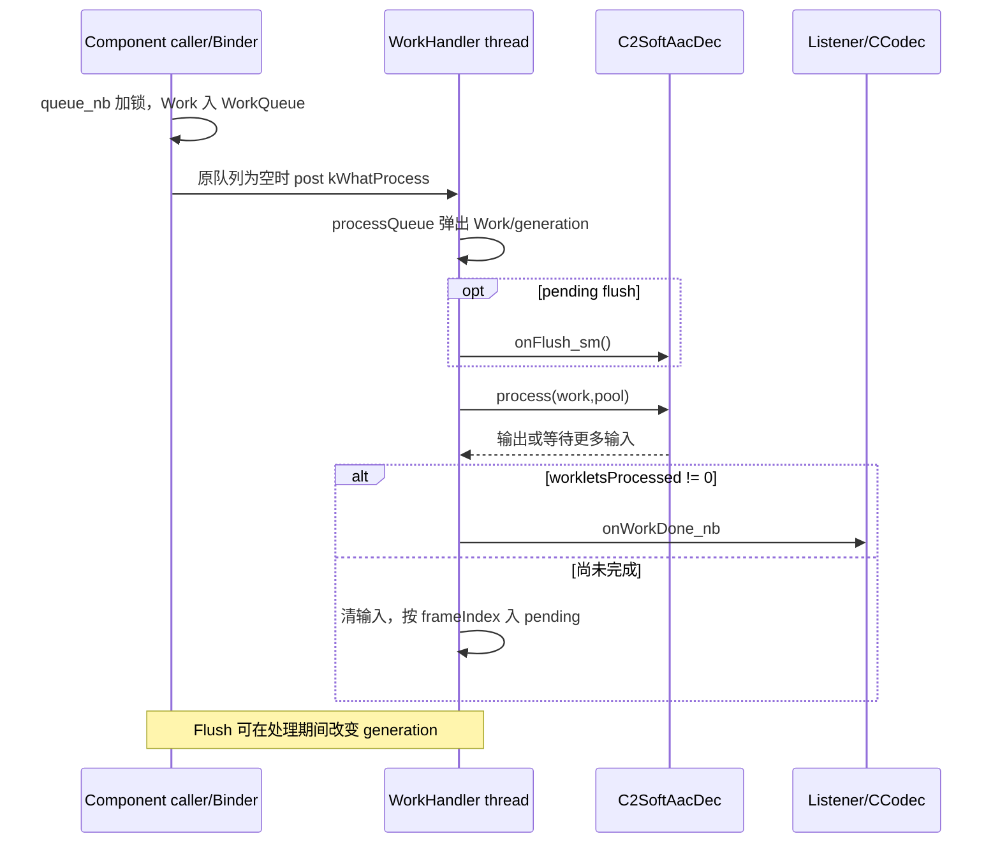

# 第 5 周：SimpleC2Component 队列、线程与生命周期

## 1. 本周学习目标与先决知识

目标：解释 Work 如何从 `queue_nb` 到 `processQueue/process`；掌握 pending work、generation、两阶段 Flush、Drain 与 Stop 的竞态；测量 queue delay、decode cost、callback lag，并做受控耗时实验。

先决知识：第 4 周 C2 对象、C++ 锁/条件变量、ALooper、智能指针。禁止在生产构建保留默认阻塞。

## 2. 关键概念

### 两类队列与 pending

- `WorkQueue` 保存已提交但未处理的 Work 或 drain 标记。
- `processQueue()` 在 `WorkHandler` 上下文弹出工作并调用派生类 `process()`。
- `workletsProcessed==0` 时，基类清空输入 Buffer，将 Work 按 frameIndex 放入 pending map，等待 `finish/cloneAndSend`。
- 已完成队列属于 CCodec/客户端侧，不能与组件 WorkQueue 混为一谈。

### generation

Flush 增加 generation，用于识别处理过程中跨越了哪代工作。`processQueue()` 如果处理期间 generation 改变，会把旧 Work 以 `C2_NOT_FOUND` 返回，避免旧输出进入新流。

### Flush 不是一次性同步清理

本树 `flush_sm()` 先清队列/pending 并设置标记，真正的派生类 `onFlush_sm()` 在后续 `processQueue()` 执行。因此 FDK 清理与上层 flushedWork 返回存在明确阶段差。

### Drain 与 Stop

Drain 用空 Work 标记请求组件排空；Stop 改变状态、清 queued/pending 并同步等待 `onStop()`。Reset 进入 UNINITIALIZED，下次 Start 会重新 `onInit()`；Release 本身不负责清队列或改变 ExecState。

## 3. 架构图：线程与消息



“`process()` 由谁调用”的精确答案：`WorkHandler::onMessageReceived` 的 `kWhatProcess` 分支调用 `processQueue()`，后者在 `SimpleC2Component.cpp:1400` 调派生类 `process()`。

## 4. 源码清单

| 顺序 | 文件：行 | 函数/结构 |
|---|---|---|
| 1 | `components/base/include/SimpleC2Component.h:132-209` | 公开接口、派生类钩子 |
| 2 | `components/base/SimpleC2Component.cpp:930-989` | `WorkHandler::onMessageReceived` |
| 3 | 同文件 `1085-1105` | `queue_nb` |
| 4 | 同文件 `1112-1138` | `flush_sm` |
| 5 | 同文件 `1140-1161` | `drain_nb` |
| 6 | 同文件 `1163-1231` | start/stop/reset/release |
| 7 | 同文件 `1247-1291` | `finish/cloneAndSend` |
| 8 | 同文件 `1293-1445` | `processQueue` |
| 9 | `components/aac/C2SoftAacDec.cpp:1072-1119` | AAC Flush/Drain 对照 |

构建：`components/base/Android.bp:22-71` 将其实现编入 `libcodec2_soft_common`。

## 5. 源码逐函数解析

### `queue_nb`

签名：`c2_status_t queue_nb(std::list<std::unique_ptr<C2Work>>* const items)`。

- **前置：** RUNNING，否则 `C2_BAD_STATE`。
- **核心：** 锁内移动 Work 到 WorkQueue；仅原队列为空时投递 `kWhatProcess`，避免重复唤醒。
- **线程：** 调用者/Binder 线程执行入队，实际处理在 WorkHandler。
- **返回：** 入队结果，不是解码结果。

### `flush_sm`

- **前置：** RUNNING。
- **核心：** generation 增加；设置 pending flush；未处理与 pending Work 移到 `flushedWork` 返回客户端。
- **异常/竞态：** 正在 `process()` 的 Work 不能简单从队列删除，由 generation 检查后处理。
- **重要：** 此函数不直接调用 `onFlush_sm()`。

### `processQueue`

1. `1299-1310` 弹 Work/drain 并读取 generation。
2. `1311-1318` 应用 pending flush。
3. `1320-1364` 首次获取输出类型与 `C2BlockPool`。
4. `1367-1375` 空 Work 触发 `drain()`。
5. `1378-1389` 应用 `input.configUpdate`。
6. `1400` 调派生类 `process()`。
7. `1402-1413` generation 改变时旧工作返回 `C2_NOT_FOUND`。
8. 已完成则回调；否则 `1422-1432` 清输入并入 pending。

返回 `true` 时 WorkHandler 继续投处理消息；不能由返回 true 推断“刚产出一帧 PCM”。

### start/stop/reset/release

- `start`：UNINITIALIZED 同步等待 `onInit`；STOPPED 重启不重新 `onInit`。
- `stop`：STOPPED，清工作，等待 `onStop`。
- `reset`：UNINITIALIZED，清工作，等待 `onReset`；下一次 start 重新初始化。
- `release`：同步 `onRelease`，自身不清队列、不改 ExecState。

## 6. 关键调用链与控制对照

```text
CCodec::start → Codec2Client::Component::start → SimpleC2Component::start
  → WorkHandler kWhatInit/kWhatStart → C2SoftAacDec::onInit

CCodecBufferChannel → Codec2Client queue → SimpleC2Component::queue_nb
  → WorkHandler kWhatProcess → processQueue → C2SoftAacDec::process

CCodec::signalFlush → Component::flush → SimpleC2Component::flush_sm
  → 后续 processQueue → C2SoftAacDec::onFlush_sm
```

Listener 的 `onWorkDone_nb` 由基类立即完成、`finish` 或 `cloneAndSend` 触发，再进入第 4 周客户端回调链。

## 7. 可复现实验

### A. 队列与处理日志

在独立分支应用调试补丁，编译部署到开发设备。开关：

```sh
adb shell setprop debug.audio.codec.trace 1
adb logcat -c
adb logcat -s SimpleC2Component C2SoftAacDec AudioCodecDebugger
```

记录 queue/decode start/decode end/callback 的单调时间、PID/TID、frameIndex/PTS、result。不同进程即便都使用 CLOCK_MONOTONIC，也要注明时钟域；不要与 wall clock 或 PTS 混合。

### B. 5/15/30 ms 耗时注入

补丁提供 `debug.audio.codec.delay.ms`，只允许 0–100 ms 的 AAC 软件解码实验：

```sh
for ms in 5 15 30; do
  adb shell setprop debug.audio.codec.delay.ms $ms
  # 重启相应媒体/Codec 实验进程后重放同一输入，保存独立日志
 done
adb shell setprop debug.audio.codec.delay.ms 0
```

48 kHz 典型 AAC 帧媒体时长约 21.333 ms。**[技术推断]** 持续 30 ms/帧的处理能力可能低于实时需求，但 App 是否能及时灌入多个 Work、队列深度和输出合并会改变现象；不能用单帧简单相除当作端到端延迟。必须观察队列增长、丢帧/反压与播放。

### C. Flush/EOS/快速 Stop

使用 `CodecFaultTest` 和 Native trace：

1. 正常 EOS：确认 drain 与最后 EOS 输出。
2. 第 20 输入后 flush：确认旧 generation 不进入新流。
3. configure/start 后立即 stop：确认无 pending 泄漏。
4. 重复实验并检查无 use-after-free、重复完成、旧帧泄露；需要 ASan/ HWASan 的单独构建配置，不能仅凭 logcat 证明内存安全。

## 8. 日志与问题定位

- `C2_BAD_STATE`：检查 start/stop/reset 次序。
- Flush 后旧 PCM：查 generation、pending、C2_NOT_FOUND 和 FDK ring buffer 是否清。
- EOS 缺尾：检查 drain 标记、AACDEC_FLUSH 和最后 pending work。
- 队列延迟升高：拆分排队、实际 decode、callback lag，不看总 PTS 差。
- 重复完成：检查当前 work 与 `finish/cloneAndSend` 是否交叉使用。
- 死锁：避免在 Listener 回调中同步等待同一 WorkHandler。

## 9. 验收清单

- [ ] 指出 `process()` 的直接调用者和所在线程。
- [ ] 解释为什么只有原队列为空时才投处理消息。
- [ ] 画出 Flush 两阶段与 generation 检查。
- [ ] 区分 queued、processing、pending、completed 四种 Work。
- [ ] 分别计算 queue delay、decode cost、callback lag。
- [ ] 比较 5/15/30 ms 注入并恢复开关为 0。
- [ ] 验证 Flush/EOS/Stop 无重复完成或旧帧泄漏。

## 10. 思考题（含答案）

**基础 1：`queue_nb` 返回成功是否表示解码成功？** 否，只表示 Work 被接受，处理结果稍后通过 Listener 返回。

**基础 2：pending Work 为什么清输入 Buffer？** 基类保留 Work/ordinal 等待后续完成，但不再需持有输入数据，可降低资源占用；输出由后续处理填充。

**基础 3：Drain 与 Stop 一样吗？** 不一样。Drain 旨在排空延迟输出，Stop 终止执行并清理工作/状态。

**进阶 1：为什么需要 generation？** 处理中的 Work 与 Flush 并发时，需要识别它属于旧流，避免旧输出混入新流。

**进阶 2：30 ms 大于 21.333 ms 是否必然听不到声音？** 不必然立即无声，缓冲可吸收短时差异；但持续处理能力低于实时会耗尽缓冲并产生反压/欠载，需实测。

**进阶 3：`release()` 是否自动完成所有队列清理？** 本树该函数只同步调用 `onRelease`，自身不清队列/改状态；上层必须按正确生命周期调用。

## 11. 参考资料

- 本地 `SimpleC2Component.h/.cpp`，提交 `frameworks/av@8fa836e6`。
- 本地 `C2SoftAacDec.cpp` Flush/Drain 实现。
- 本交付 `patches/` 与 `scripts/analyze_latency.py`。

## 12. 版本差异与未验证事项

- **已验证：** 本树队列、pending、generation 和生命周期代码行为。
- **技术推断：** 耗时注入对实时性的影响需设备输入/队列条件，不预设必然结果。
- **待验证：** Native 补丁编译、部署、线程 TID、5/15/30 ms 实测、ASan/Hwasan。
- 其他 Android 版本的 `processQueue` 结构可能不同，必须重新定位，不沿用 1400 行号。
