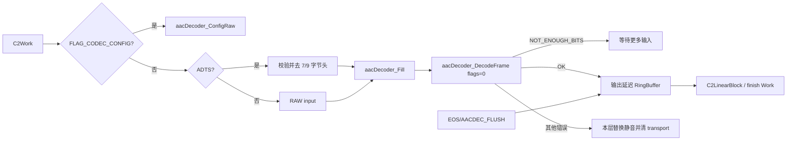

# 第 6 周：C2SoftAacDec 与 FDK-AAC 解码核心

## 1. 本周学习目标与先决知识

目标：逐步解释 CSD/ADTS/RAW 如何进入 FDK；掌握输入消费、输出 PCM、StreamInfo、输出延迟补偿、错误隐藏、Flush/EOS；能用日志证明设备进入 `C2SoftAacDec::process()`。

先决知识：第 1/4/5 周，C++ RAII、位流基础。行号基于本地 `frameworks/av@8fa836e6`、`external/aac@c25fba6e` 当前工作树。

## 2. 关键概念：适配层与算法库边界

`C2SoftAacDec` 负责：C2 参数、C2 Buffer map、CSD/ADTS 适配、FDK 调用、错误到 C2 的映射、输出延迟 ring buffer、动态格式、pending Work 完成。

FDK-AAC 负责：transport 输入缓冲、访问单元读取、AAC 核心解码、concealment、StreamInfo、交错 PCM 输出。



**一个输入被消费与一个输出产生是不同事件。** `Fill` 可缓存；`DecodeFrame` 可数据不足；ring buffer 又引入输出延迟。

## 3. 初始化、CSD 与 StreamInfo

### `onInit/initDecoder`

- `onInit()`：`337-340`，调 `initDecoder`，非 OK 映射 `C2_CORRUPTED`。
- `initDecoder()`：`374-447`；`377` 调 `aacDecoder_Open(TT_MP4_ADIF, 1)`，`379` 取得 `mStreamInfo`。
- `385-390` 分配输出延迟 ring buffer；`398-444` 初始化 DRC、UniDRC effect/album mode、最大输出声道。
- 本层这些 `aacDecoder_SetParam` 返回值未检查，调试时不能声称设置一定成功。

### CSD

`process()` 在 `649-657` 对 `FLAG_CODEC_CONFIG` 且非空输入调用 `aacDecoder_ConfigRaw`。失败在 `659-663` 置 `mSignalledError` 和 `C2_CORRUPTED`；成功在 `665-668` 清输出并返回，不产生 PCM。

M4A 的 ASC 通常由此进入；ADTS 裸流则通过后续头解析和 FDK transport 获得流配置。

### `CStreamInfo`

公开结构在 `aacdecoder_lib.h:795` 起，本教程重点：

- `sampleRate/frameSize/numChannels`：实际输出格式依据。
- `outputDelay`：FDK 输出延迟信息。
- `numTotalBytes`：累计消费计数，本层用差值记录 `numConsumed`。

`aacDecoder_GetStreamInfo` 返回内部结构指针；核心 `CAacDecoder_GetStreamInfo`（`aacdecoder.cpp:3585-3590`）不是复制结构，因此使用时必须保证 handle 生命周期。

## 4. 源码清单

| 顺序 | 文件：行 | 函数/结构 |
|---|---|---|
| 1 | `components/aac/C2SoftAacDec.h:28-47,79-91` | 生命周期/process/drain 私有接口 |
| 2 | `C2SoftAacDec.cpp:337-447` | onInit/onStop/onReset/onRelease/initDecoder |
| 3 | 同文件 `613-1026` | `process` 主链 |
| 4 | 同文件 `1028-1119` | drainInternal/onFlush_sm/drainDecoder |
| 5 | `external/aac/libAACdec/include/aacdecoder_lib.h:442-561,795-849,951-1068` | 错误、StreamInfo、API |
| 6 | `libAACdec/src/aacdecoder_lib.cpp:1063-1087` | Fill 包装 |
| 7 | 同文件 `1149-2042` | DecodeFrame 包装与 interleave |
| 8 | `libAACdec/src/aacdecoder.cpp:2481-2510,3585` | 核心解码与 StreamInfo |

组件名 `c2.android.aac.decoder` 在 `C2SoftAacDec.cpp:57`；构建目标 `libcodec2_soft_aacdec`，链接 `libFraunhoferAAC`。

## 5. 源码逐函数解析

### `C2SoftAacDec::process`

真实签名（`613`）：

```cpp
void C2SoftAacDec::process(
        const std::unique_ptr<C2Work> &work,
        const std::shared_ptr<C2BlockPool> &pool)
```

- `616-620`：result=C2_OK、workletsProcessed=1、复制输入 flags。
- `622-624`：已 signalled error 时直接返回。
- `634-637`：映射首输入 LinearBlock，记录 size。
- `639-640`：读取 EOS/CSD flags。
- `671-675`：保存 frameIndex、timestamp、bufferSize 到 `Info`。
- 循环中处理 ADTS 或 RAW， Fill 后更新 offset/size，再 DecodeFrame。

### ADTS 与输入消费

`678-725` 检查最小头和完整帧；7/9 字节头被剥离。`739-742` 调 Fill，**返回值在本层被忽略**。`790-792`：

```cpp
UINT inBufferUsedLength = inBufferLength[0] - bytesValid[0];
size -= inBufferUsedLength;
offset += inBufferUsedLength;
```

这说明“消费输入”由 Fill 更新的 `bytesValid` 计算，不等于本次 Work 的原始大小。若本层后续 `bytesValid[0]!=0`，`821-825` 视为异常并置 C2_CORRUPTED。

### DecodeFrame 与错误

`804-808` 调：

```cpp
aacDecoder_DecodeFrame(mAACDecoder, tmpOutBuffer,
                       2048 * MAX_CHANNEL_COUNT, 0);
```

- `AAC_DEC_NOT_ENOUGH_BITS`（`812-814`）：退出当前 decode 循环，等待更多输入，不当永久错误。
- 其他非 OK（`817-853`）：记录警告，将一个输出帧替换为静音，丢弃剩余输入并设置 `AAC_TPDEC_CLEAR_BUFFER`。
- 即使某些 FDK decode-error 按 `IS_OUTPUT_VALID` 可含 concealment PCM，**本 C2 适配层仍统一替换为静音**。
- ring buffer 写入或动态配置失败可置 `mSignalledError/C2_CORRUPTED`。

### PCM 输出与格式

`828-829` 典型输出量按 `frameSize × sizeof(int16_t) × numChannels`。`drainRingBuffer()`（`553-590`）分配 C2LinearBlock 并写出。FDK 包装层最终在 `aacdecoder_lib.cpp:1995-2013` 通过 `FDK_interleave` 形成交错 PCM。

采样率/声道变化在 `883-910` 通过 `configUpdate` 上报；`946-953` 有 Android S 起 DRC compression mode 上报变化；`982-1005` 根据 `outputDelay` 更新实际端口延迟。正常 process 可设 `workletsProcessed=0` 进入 pending，等有足够补偿后的 PCM 再完成。

### onFlush/onStop/onReset/onRelease

- `onFlush_sm`：`1072-1090`，先 `drainDecoder`，清 `mBuffersInfo`，丢弃 ring 中全部样本，不重开 decoder。
- `onStop`：`342-360`，drain、清状态、关闭并重新 init decoder、清错误。
- `onReset`：`362-364`，只调 `onStop`。
- `onRelease`：`366-372`，关闭 handle、置空、释放 ring；析构也调用它。

### EOS/Drain

EOS 在 `1021-1024` 进入 `drainInternal(DRAIN_COMPONENT_WITH_EOS,...)`。`drainDecoder`（`1092-1119`）使用 `aacDecoder_DecodeFrame(..., AACDEC_FLUSH)` 取延迟音频。EOS 时以空输出完成剩余 pending work，保留最后 EOS flag。

## 6. FDK 三层调用链

```text
SimpleC2Component::processQueue
 → C2SoftAacDec::process
 → aacDecoder_Fill
    → transportDec_FillData
 → aacDecoder_DecodeFrame
    → transportDec_ReadAccessUnit
    → CAacDecoder_DecodeFrame
    → FDK_interleave
 → CStreamInfo / outputDelay ring buffer
 → finish / drainRingBuffer / C2Work output
```

公开签名见 `aacdecoder_lib.h:951-1068`。Fill 包装在 transport 非 OK 时映射 `AAC_DEC_UNKNOWN`；DecodeFrame 对空 handle、数据不足、同步、CRC、输出容量等有各自错误路径。`AAC_DEC_NOT_ENOUGH_BITS=0x1002`；`0x4000-0x4FFF` decode-error 可含有效 concealment 输出，是否采用由上层决定。

## 7. 可复现实验

### A. 一次真实输入 Trace

应用调试补丁并开启：

```sh
adb shell setprop debug.audio.codec.trace 1
adb shell setprop debug.audio.codec.delay.ms 0
adb logcat -c
# 运行 Android decode_m4a，显式选择 c2.android.aac.decoder
adb logcat -d -s C2SoftAacDec SimpleC2Component AudioCodecDebugger
```

必须同时有组件枚举名称和 `C2SoftAacDec` 的 process trace，才能证明进入该实现。记录 frameIndex、PTS、输入 size、Fill consumed、DecodeFrame result、numConsumed、frameSize/rate/channels、输出 size、monotonic start/end。

### B. 4096 字节典型例

48 kHz、双声道、AAC-LC、PCM16 且 `frameSize=1024` 时：

```text
1024 × 2 × 2 = 4096 bytes
```

在 trace 中核对实际 `frameSize`，不要把每次 `outputBytes=4096` 当合同。输出 ring buffer 可让 Work 输出为空、延后或与 EOS 相关。

### C. 异常矩阵

使用输入副本，不修改原文件：

| 用例 | 观察 |
|---|---|
| 错误/空 CSD | ConfigRaw result、C2_CORRUPTED、mSignalledError |
| ADTS 短于 7 字节 | 本层 hexdump/损坏结果 |
| 声明长度大于剩余 | 不完整帧分支 |
| RAW 截断 | NOT_ENOUGH_BITS 或其他 FDK 错误 |
| 中间 payload 损坏 | 静音替换、CLEAR_BUFFER、后续恢复 |
| 动态采样率/声道 | configUpdate 与 PCM 文件分段处理 |

动态格式输出到一个无头 PCM 文件会造成前后解释冲突；正式工具应分段或转 WAV。

## 8. 日志与问题定位

- **无输出但输入被消费：** 查 NOT_ENOUGH_BITS、outputDelay、pending，不立即判丢帧。
- **错误后一段静音：** 本层非 OK 分支可能主动替换，不一定是 FDK 算法输出。
- **Fill 看似无错误但数据异常：** 本层忽略 Fill 返回值，可在实验补丁中补充记录，不能改变默认错误行为。
- **PTS 与输出错位：** 查 `mBuffersInfo`、ring buffer、drain 和 frameIndex，不以输入队列顺序硬配。
- **Stop 后状态不同：** onStop 会重建 decoder；onRelease 才真正关闭并不再使用。
- **FDK handle 无效：** 检查 onRelease 后是否仍有异步 process/StreamInfo 使用。

## 9. 验收清单

- [ ] 从 CSD 或 ADTS 输入逐步讲到 FDK PCM 输出。
- [ ] 解释 Fill 的 bytesValid 与输入消费。
- [ ] 区分 NOT_ENOUGH_BITS 与其他解码错误。
- [ ] 解释为什么本层可能输出静音而非 concealment PCM。
- [ ] 用实际 StreamInfo 验证一次 4096 字节典型例及一个例外。
- [ ] 描述 outputDelay ring buffer 与 pending Work。
- [ ] 验证 Flush、EOS、Stop、Release 的 handle/缓冲行为。

## 10. 思考题（含答案）

**基础 1：CSD 输入会立即产生 PCM 吗？** 本层 ConfigRaw 成功清输出并返回，不把 CSD 当音频帧。

**基础 2：NOT_ENOUGH_BITS 是否必须停止播放？** 本层将其视为等待更多输入的可恢复状态，不直接置永久错误。

**基础 3：`frameSize` 是否永远 1024？** 否，应以 StreamInfo 和实际 AAC 工具为准；SBR 等可能改变输出观察。

**进阶 1：为何 `aacDecoder_Fill` 后还要循环 DecodeFrame？** 输入缓冲可包含足够一个或多个访问单元，输出与输入消费分离，需要按数据可用性驱动解码。

**进阶 2：为什么 EOS 需要 AACDEC_FLUSH？** 解码器/输出补偿内部仍有延迟样本，单纯停止提交输入不能取完尾部。

**进阶 3：FDK decode-error 可含有效输出，本层为何仍可能静音？** 公共 FDK API 允许 concealment 输出，但本 C2SoftAacDec 非 OK 分支主动替换静音，这是适配层策略。

## 11. 参考资料

- 本地 `C2SoftAacDec.cpp/.h`、`Android.bp`。
- 本地 `aacdecoder_lib.h/.cpp`、`aacdecoder.cpp`，FDK API 3.2.0。
- AOSP 官方源码仅辅助，不覆盖本树策略。

## 12. 版本差异与未验证事项

- **已验证：** 本层函数、错误替换、Fill 返回值忽略、Flush/EOS/生命周期和 FDK 包装行为。
- **技术推断：** 典型 Work 观察模式依输入与延迟，不作为输出数量合同。
- **待验证：** 实际 trace、坏 CSD/短包/动态格式日志、PCM 样本数、Native 编译部署。
- 本树含 UniDRC 与 API S 条件逻辑；其他版本字段、DRC 默认值和端口延迟可能不同。
