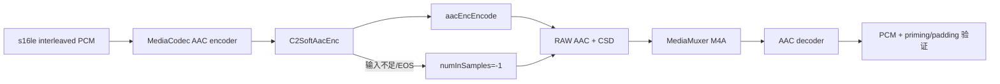

# 第 7 周：AAC 编码器与异常/状态机实战

## 1. 本周学习目标与先决知识

目标：跟踪 PCM→C2SoftAacEnc→FDK AAC→M4A；理解输入缓存、CSD 生成、Priming/Padding、EOS/Drain/Flush；构造异常矩阵并依据实际源码决定恢复或退出。

先决知识：第 1/5/6 周、MediaMuxer、PCM 交错布局。编码器不是解码器的简单逆过程，生命周期和错误映射存在显著差异。

## 2. 关键概念

### 编码输入与输出

App 输入 PCM16，Codec 配置采样率、声道、码率、AAC-LC profile。FDK 按自身帧长缓存输入，因此一次输入 Buffer 不必等于一个 AAC access unit。输出通过 MediaMuxer 写入 M4A，编码器输出格式中的 CSD 由 muxer 写入容器，而不是手工给每帧加 ADTS。

### Priming / Padding

编码器延迟使初始输出与原始 PCM 不完全对齐，尾部可能含 padding。M4A 可保存相关元数据；解码后有效样本数由容器与解码器共同处理。比较波形时先确认有效区间，再计算误差。

### Flush / Drain / EOS

- **EOS：** 没有更多 PCM，要求编码器输出剩余码流。
- **Drain：** 组件层排空语义；本编码器的 FDK flush 主要在 `process()` 的 EOS 路径，不在 `drain()` 中直接完成。
- **Flush：** 放弃当前流并重新初始化编码状态，不应把它当“取完剩余数据”。
- **Stop/Reset/Release：** 按本类真实实现分别分析，不能套用解码器 handle 行为。

### 异常恢复原则

可恢复错误要有数据边界与后续同步策略；配置失败、资源耗尽、不可恢复组件错误应退出并释放。损坏输入被 Codec 接受不等于输出正确；静音替代、错误隐藏和 C2 result 需一起观察。

## 3. 架构图：PCM 往返



## 4. 源码清单

| 顺序 | 文件：行 | 重点 |
|---|---|---|
| 1 | `components/aac/C2SoftAacEnc.h:30-50` | 生命周期/process/drain |
| 2 | `C2SoftAacEnc.cpp:180-191` | onInit/initEncoder |
| 3 | 同文件 `204-226` | onReset/onRelease/onFlush_sm |
| 4 | 同文件 `291,358-400` | TT_MP4_RAW、初始化、CSD |
| 5 | 同文件 `480-623` | process、FillWork、aacEncEncode、多输出 |
| 6 | 同文件 `626-651` | drain |
| 7 | `components/aac/Android.bp:37-49` | `libcodec2_soft_aacenc` |
| 8 | `external/aac/libAACenc/include/aacenc_lib.h` | FDK 编码 API（按本树继续阅读） |
| 9 | Android `AacEncoder.java` | PCM 分块、PTS、Muxer、EOS |

组件名 `c2.android.aac.encoder`（`C2SoftAacEnc.cpp:34`），工厂/导出在 `654-700`。

## 5. 源码逐函数解析

### onInit / setAudioParams

`onInit()` 在 `180-191` 进入 `initEncoder()`，调用 `aacEncOpen()` 和 `setAudioParams()`。输出 transport 在 `291` 设置为 `TT_MP4_RAW`，因此 C2 编码输出不是自动 ADTS。

前置：合法输入 PCM 参数与组件状态。失败路径需检查 FDK 返回与 C2 状态；实际配置以本树参数 setter 为准。

### 首次 process 与 CSD

第一次 `process()`：

1. `358-367` 以空输入调用 `aacEncEncode()` 完成初始化。
2. `375-400` 通过 `aacEncInfo()` 取得 CSD、最大输出大小、输入帧长。
3. CSD 通过 `C2StreamInitDataInfo::output` 的 `configUpdate` 上报。

上层 MediaMuxer 必须等 `INFO_OUTPUT_FORMAT_CHANGED` 后 `addTrack/start`，不能在格式未确定时写 sample。

### 正式编码与 EOS

正式 `aacEncEncode()` 在 `551-555`。输入不足一个交错采样帧且 EOS 时，`547-550` 将 `inargs.numInSamples=-1` 请求 FDK flush。多输出时前面的经 `cloneAndSend()` 返回并带 `FLAG_INCOMPLETE`，最后一个当前 Work 在 `603-623` 返回并带 EOS。

**本树异常细节：** 正式编码非 `AACENC_OK` 分支（`582-587`）丢弃剩余输入并退出循环，而 `FillWork` 在 `480-485` 又设 `work->result=C2_OK`。不能声称“所有编码错误都会映射为 C2 错误”；实验应补充 FDK 日志验证。

### Flush/Reset/Release/Drain

- `onFlush_sm`：`213-226` 用 `AACENC_CONTROL_STATE/AACENC_INIT_ALL` 重置；失败只记录，仍返回 C2_OK。
- `onReset`：`204-211` 关闭 encoder。
- `onRelease`：此处为 no-op，与解码器不同。
- `drain(DRAIN_COMPONENT_WITH_EOS)`：`626-651` 重置时间戳/CSD 状态，注明无 pending work；FDK flush 不在这里执行。

## 6. 关键调用链

```text
MainActivity encode
 → AacEncoder.encode
 → MediaCodec.createEncoderByType(audio/mp4a-latm)
 → configure/start
 → PCM chunk + queueInputBuffer(PTS)
 → C2SoftAacEnc::process
 → aacEncEncode（含 EOS numInSamples=-1）
 → output format(CSD) → MediaMuxer.addTrack/start
 → writeSampleData → output EOS → stop/release
```

App PTS 由累计完整 PCM 帧计算：`inputFrames × 1,000,000 / sampleRate`，避免每块浮点累加误差。它仍是媒体时间，不是编码耗时。

## 7. 可复现实验

### A. PCM→AAC→PCM 往返

```powershell
python AudioCodecDebugger/scripts/generate_test_files.py --output AudioCodecDebugger/test_data
# push sine_48k_stereo_s16le.pcm 为 input.pcm
adb shell am start -n com.example.audiocodecdebugger/.MainActivity --es action encode
# pull encoded.m4a 后，可再作为 input.m4a 解码
python AudioCodecDebugger/scripts/compare_pcm.py original.pcm decoded.pcm --sample-rate 48000 --channels 2 --scan-delay 4096
```

记录：输入 PCM 帧数、编码包数、M4A 时长、解码样本数、检测 lag、RMS/SNR。AAC 有损，不要求 bit-exact。自动 lag 只作诊断，最终需与容器 priming/padding 元数据对照。

### B. 损坏流与恢复

使用第 2 周解码器和 `CodecFaultTest`：

1. 中间翻转载荷位。
2. 截断最后若干字节。
3. 错 CSD、短包、ADTS 错帧长。
4. 记录 CodecException、C2 result、FDK result、输出静音长度、后续 PTS。

“解码完成”只表示状态机走完，需进一步验证 PCM 连续性和错误区间。

### C. 状态测试矩阵

| 状态/操作 | 输入 | 必查项 |
|---|---|---|
| configure 前 start | 无 | Java 状态异常 |
| start 后立即 stop | 无 | 无 Work 泄漏 |
| 编码中途 flush | PCM 副本 | CSD/时间戳是否重新开始 |
| 正常 EOS | 完整 PCM | FDK flush、最后输出 EOS |
| EOS 后继续输入 | 不合规 | 拒绝/异常，不吞错 |
| release 后操作 | 无 | 状态异常 |
| 输出不释放 | AAC 解码 M4A | 反压与恢复 |

## 8. 日志与问题定位

- Muxer 报未 start：检查是否先收到输出格式变化。
- 输出无 CSD：检查首次 process/aacEncInfo/configUpdate。
- 结尾变短：检查 EOS `numInSamples=-1`、最后 output EOS、Muxer stop。
- 开头错位：检查 priming/edit list，不用任意固定 1024 样本裁剪。
- 编码错误却 result OK：本树已知路径可能如此，增加 FDK error 日志。
- Flush 后旧码流：检查 AACENC_INIT_ALL 返回与 CSD 状态。
- PCM 长度不是 `channels×2` 整数倍：实验编码器明确拒绝尾部半帧。

## 9. 验收清单

- [ ] 解释 PCM 输入块与 AAC 输出帧不一一对应。
- [ ] 追踪 CSD 从 aacEncInfo 到 M4A。
- [ ] 正常 EOS 能取到尾部输出并正确关闭 Muxer。
- [ ] 区分 Flush 与 Drain/EOS，并指出本类 FDK flush 所在函数。
- [ ] 对齐 priming/padding 后比较样本数和波形。
- [ ] 构造至少 4 种异常并记录恢复/失败依据。
- [ ] 说明编码器 onRelease 与解码器的差异。

## 10. 思考题（含答案）

**基础 1：AAC 编码输出为何不是自动 ADTS？** 本组件设置 `TT_MP4_RAW`，ADTS 是另一传输封装；M4A 使用 RAW AAC+CSD。

**基础 2：为什么 Muxer 必须等格式变化？** 此时才有完整输出格式和 CSD，才能 addTrack/start。

**基础 3：AAC 往返为何不应 bit-exact？** AAC 通常有损，量化/心理声学改变样本；评价应看有效区间、波形和误差。

**进阶 1：为什么不能用固定 1024 样本解决所有延迟？** 编码器实现、SBR、容器元数据和尾部 padding 不同，需读取实际信息。

**进阶 2：本编码器 drain 为何不直接 FDK flush？** 当前实现把 EOS flush 放在 process 输入不足分支，drain 只处理状态且注明无 pending work，这是本树实现选择。

**进阶 3：为何 result OK 仍需记录 FDK error？** 本树正式编码非 OK 路径未可靠传播到最终 Work result，单看 C2_OK 会漏掉内部失败。

## 11. 参考资料

- 本地 `C2SoftAacEnc.cpp/.h`、`components/aac/Android.bp`。
- 本地 `external/aac` 编码器接口。
- Android MediaMuxer 文档：https://developer.android.com/reference/android/media/MediaMuxer
- 本交付 `AacEncoder.java`、`compare_pcm.py`。

## 12. 版本差异与未验证事项

- **已验证：** 本地编码初始化、CSD、EOS、错误传播和生命周期源码。
- **技术推断：** 波形/样本对齐需在具体 FFmpeg/设备编码器输出上测量。
- **待验证：** 设备编码、M4A 元数据、延迟扫描、错误矩阵、Native FDK trace。
- 不把编码器 `onRelease=no-op` 或错误传播策略推广到其他 Android 版本。
