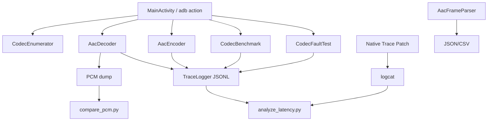
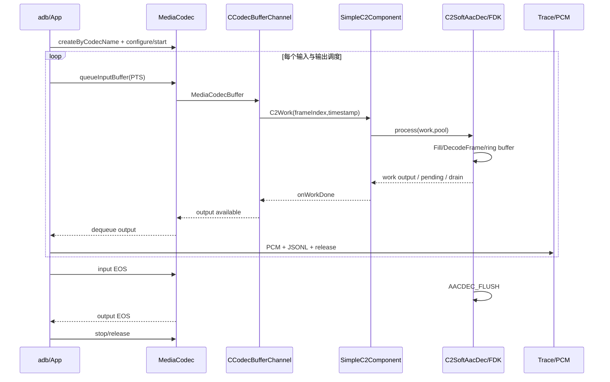

# 第 8 周：AudioCodecDebugger 综合实验与最终验收

## 1. 本周学习目标与先决知识

目标：整合组件枚举、AAC 解码/编码、基准、故障注入、统一 Trace；在真实开发设备上显式选择软件 AAC Codec，证明进入 `C2SoftAacDec::process()`，生成 PCM、调用时序和可复核报告。

先决知识：完成前 7 周；具备开发设备、Android SDK、源码编译部署权限。刷写/替换库只在独立实验分支与开发设备执行。

## 2. 关键概念：证据链而非“跑通一次”

最终结论需要三类证据互相闭合：

1. **选择证据：** `MediaCodecList` 中存在并显式选择 `c2.android.aac.decoder`。
2. **执行证据：** Native trace/断点到达 `SimpleC2Component::processQueue → C2SoftAacDec::process → FDK`。
3. **数据证据：** 输入/输出字节、PTS、格式、EOS、PCM 可播放且释放计数一致。

只有进程名、XML、`lshal` 或“PCM 有声音”之一都不充分。若源码与设备库不是同一构建，要记录 build fingerprint 和库来源，不能声称验证了 HEAD 行为。

## 3. 架构图：诊断工具



推荐模块在本工程合并为单 App 包，减少跨模块样板；Native parser 和 Python 工具独立运行。

## 4. 源码与交付清单

| 模块 | 真实文件 | 验证目标 |
|---|---|---|
| CodecEnumerator | `android/.../CodecEnumerator.java` | 名称、类型、软件/硬件/厂商属性 |
| AacDecoder | `android/.../AacDecoder.java` | M4A/ADTS、PTS、格式、EOS、释放 |
| AacEncoder | `android/.../AacEncoder.java` | PCM16→AAC/M4A、CSD、PTS |
| CodecBenchmark | `android/.../CodecBenchmark.java` | wall time、output wait、P95/P99 |
| CodecFaultTest | `android/.../CodecFaultTest.java` | 截断/损坏/Flush/Stop/反压 |
| TraceCollector | `TraceLogger.java` + Native patch | 统一字段与单调时钟 |
| AacFrameParser | `native/AacFrameParser/` | ADTS 结构与损坏检测 |
| PcmDump | `AacDecoder` + `compare_pcm.py` | PCM 文件与样本对比 |
| 测试素材 | `scripts/generate_test_files.py` | 可重复 PCM/ADTS/FFmpeg 输入 |

完整路径前缀为 `AudioCodecDebugger/`。Native 源码映射见 `00`。

## 5. 源码逐函数解析：一次综合运行

### `MainActivity.execute`

在 UI 线程取得组件名，单后台 Executor 执行动作，结果同时写 UI 和 logcat。支持 `enumerate/decode_m4a/decode_aac/encode/benchmark/fault` adb extras。

### `AacDecoder.decode`

见第 2 周。综合验收重点检查 `Result.outputCount == outputReleasedCount`、实际输出格式、120 秒 stall、JSONL 完整关闭。Native 时间不能在 App 层伪造，因此 App 只记录 `outputWaitNs`。

### `CodecBenchmark.run`

同一输入重复 1–100 次，当前 UI 为 3 次。每次生成独立 trace，删除临时 PCM，保存 `benchmark_summary.json`。统计：

- `wallDecodeMs`：整次 App decode，包括 Extractor、IO、调度和释放。
- `appOutputWaitMs`：dequeue 等待。
- Native 补丁后才可有 queueDelay/decodeCost/callbackLag。

P95/P99 使用 nearest-rank；少量迭代时分位数只作观察，不能伪装 statistically significant。

### `CodecFaultTest.runAll`

所有破坏都作用于 `output/fault` 副本。单个用例失败被记录后继续其他用例；这是测试矩阵，不应把“故障测试完成”理解为所有输入都被拒绝。

## 6. 关键调用链与最终时序



## 7. 可复现实验：最终验收步骤

### 1. 固定版本

```powershell
git -c safe.directory='*' -C Z:/work/DP8678GPU_GRP/android/system/frameworks/av rev-parse HEAD
adb shell getprop ro.build.fingerprint
adb shell getprop ro.build.version.sdk
```

`-c safe.directory` 只对单次只读命令生效，不修改全局配置。记录源码是否有本地改动。

### 2. 主机测试与 APK

```powershell
python -m unittest discover -s AudioCodecDebugger/tests -v
cd AudioCodecDebugger/android
.\gradlew.bat assembleDebug
adb install -r app/build/outputs/apk/debug/app-debug.apk
```

### 3. 输入与组件

按 Android README push `input.m4a/input.aac/input.pcm`，先运行 `enumerate`。只有枚举存在时才显式填 `c2.android.aac.decoder`，否则记录实际组件，不伪造成功。

### 4. Native trace（开发设备）

1. 在 `frameworks/av` 独立分支 `git apply --check` 补丁，再应用。
2. 按项目 lunch 目标编译相关库/镜像。
3. 备份并确认 APEX/AVB/签名要求后部署。
4. `setprop debug.audio.codec.trace 1`，delay 保持 0。
5. 重启必要媒体组件进程，运行 decode。
6. 结束后恢复属性、撤销补丁并回到原构建。

具体编译/刷写命令必须由项目构建环境确认；本教程不谎称已执行。

### 5. PCM、数据和稳定性

- 正常 M4A/ADTS 解码，输出 EOS，释放计数一致。
- `ffplay` 按实际格式播放 PCM。
- `compare_pcm.py` 对齐后评估，AAC 不要求 bit-exact。
- 连续 5 分钟输入，至少重复 3 次。
- 执行 benchmark/fault，保存 JSONL、logcat 和摘要。

## 8. 日志与问题定位

### 统一字段

Native 推荐字段：`frameIndex, ptsUs, inputBytes, outputBytes, queueTimeNs, decodeStartNs, decodeEndNs, callbackTimeNs, result`，另加 PID/TID/component。

```text
queueDelayNs  = decodeStartNs - queueTimeNs
decodeCostNs  = decodeEndNs - decodeStartNs
callbackLagNs = callbackTimeNs - decodeEndNs
```

全部来自一致单调时钟；跨进程注明时钟域。App JSONL 的 `monotonicNs` 由 `System.nanoTime()` 提供，Native 不应混用 wall clock。Flush/取消/重排时不能只按 frameIndex 配对。

### 最低故障集

无 AAC track、Codec 名不存在、configure 失败、输入容量不足、CSD 错误、ADTS 截断、FDK 数据不足、输出格式变化、输出 Buffer 不释放、EOS 缺失、Stop 竞态。逐项参考 `10_常见故障排查手册.md`。

## 9. 最终验收清单

- [ ] 记录源码 HEAD、本地改动、设备 fingerprint/SDK。
- [ ] MediaCodecList 证明实际组件并显式选择软件 AAC。
- [ ] Native trace/断点证明进入 `C2SoftAacDec::process()`。
- [ ] 追踪到 Fill、DecodeFrame、GetStreamInfo/输出。
- [ ] M4A 与 ADTS 均正常解码并输出可验证 PCM。
- [ ] 输入/输出/EOS/释放计数完整，无 Buffer 泄露。
- [ ] 5 分钟连续解码至少 3 次无停滞/崩溃。
- [ ] 有 queue/decode/callback 分离指标，不混淆 PTS。
- [ ] 故障矩阵含截断、坏 CSD、Flush、Stop、反压。
- [ ] 所有调试属性恢复，补丁可撤销，生产默认行为不变。

## 10. 思考题（含答案）

**基础 1：为什么 PCM 有声音不足以证明走了软件 AAC？** 可能选了硬件/其他组件；需实际名称与 Native trace。

**基础 2：为什么 benchmark 不能只看平均值？** 尾延迟和卡顿由 P95/P99/max 更易暴露，平均会掩盖异常。

**基础 3：为什么故障输入必须复制？** 保留原始证据、可重复运行并避免破坏唯一测试素材。

**进阶 1：App outputWait 为何不是 decodeCost？** 它包含排队、调度和无输出等待，且没有 Native decode start/end。

**进阶 2：源码 HEAD 与设备库不同还能下行为结论吗？** 只能分别报告源码行为与设备观察，不能将设备结果归因于未部署的 HEAD。

**进阶 3：为何 3 次 benchmark 的 P99 不宜作严格性能承诺？** 样本太少，nearest-rank 基本是最大值，不能代表稳定尾部分布。

## 11. 参考资料

- 本交付 Android/Native/scripts/patches 全部源码。
- 本地 `C2SoftAacDec.cpp`、`SimpleC2Component.cpp`、`CCodecBufferChannel.cpp`。
- Android MediaCodec/MediaCodecList 官方文档。

## 12. 版本差异与未验证事项

- **已实测：** 主机 Python 测试通过；Android Java 使用本地 API 35 桩编译通过；Gradle Wrapper 启动通过。
- **未实测：** C++ 编译（无编译器）、FFmpeg（未安装）、APK assemble（无完整 SDK）、ADB 设备、Native 编译/部署。
- **待生成：** 真实 logcat、Native trace、PCM 设备输出、5 分钟测试、benchmark/fault 设备报告。
- 后续扩展：异步 MediaCodec 回调、HWASan、Systrace/Perfetto、更多 AAC profile、硬件 Codec 对照、Perfetto 跨进程时钟关联。
