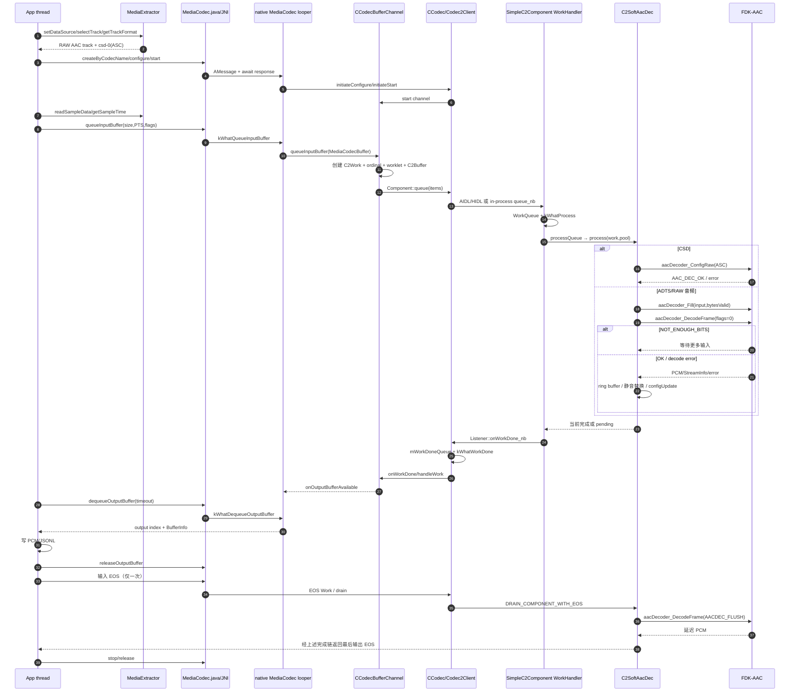
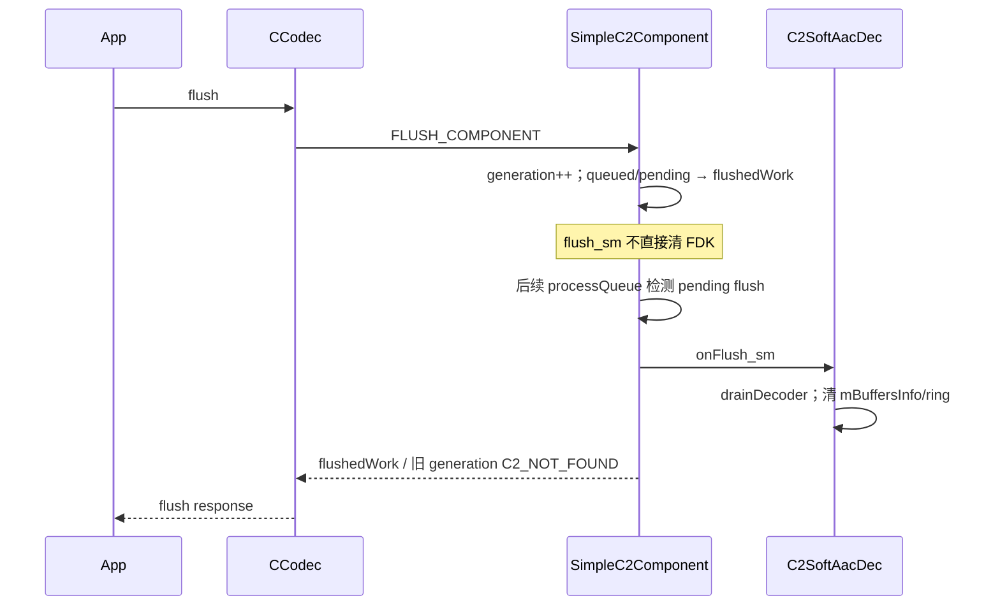

# 09 全链路时序图与术语表

## 1. 阅读约定

本图基于本地 MTK8678 工作树。实线调用不代表同一线程；控制 API 常投递消息并等待响应，Work 完成则异步返回。普通 Codec2 组件经 AIDL/HIDL Binder，`__ApexCodecs__` 是本树明确的 in-process 例外。

## 2. M4A/AAC 解码全链路

## 3. Flush 与异常时序

正在 `process()` 的旧 Work 通过 generation 处理；Flush 后不得把旧 PCM 当新流。Stop/Reset/Release 是不同路径，见第 5/6 周。

## 4. PCM 播放边界（非本教程主体）

MediaCodec 输出 PCM 文件无需 AudioTrack。端到端播放延迟还包含 App 缓冲、AudioFlinger 混音、HAL 与硬件 FIFO，不等于解码耗时。

## 5. 术语表

| 术语 | 含义与常见误区 |
|---|---|
| AAC | 音频编码标准/工具集合，不等于某种文件容器 |
| AAC-LC | 常见低复杂度 profile，典型 1024 samples/access unit/channel |
| ADTS | 带 sync、长度和流配置的裸流传输头，7/9 字节 |
| ASC | AudioSpecificConfig，描述对象类型、采样率、声道等 |
| CSD | Codec Specific Data；M4A AAC 的 `csd-0` 通常承载 ASC，不是 ADTS 头 |
| M4A/MP4 | 容器；Extractor 解封装，Codec 不解 MP4 box |
| Access Unit | 编码访问单元，不严格等于 Work 或输出 Buffer |
| PCM | 脉冲编码调制样本；本实验输出 s16le 交错 |
| PTS | 媒体显示时间，不能用作单调耗时钟 |
| MediaExtractor | 轨道/sample/CSD 解封装 |
| MediaCodec | Android 编解码 API 与 Native 状态机 |
| CCodec | MediaCodec 的 Codec2 后端控制和 Listener |
| CCodecBufferChannel | MediaCodec Buffer 与 C2 Work/Buffer 的桥接 |
| Codec2Client | AIDL/HIDL 客户端代理；本树实现在 `hal/client/client.cpp` |
| C2Component | Codec2 执行组件接口 |
| C2ComponentInterface | 组件参数/能力接口 |
| C2Work | 输入、worklets、processed、result 的工作容器 |
| C2Worklet | Work 中输出工作单元 |
| C2Buffer | C2 block 组合视图，不是 Java ByteBuffer |
| C2BlockPool | C2 输出块分配/复用来源 |
| SimpleC2Component | 软件组件队列/WorkHandler/pending/生命周期基类 |
| frameIndex | 内部工作序号，不是 PTS，也不保证无取消/重排 |
| workletsProcessed | 决定当前 worklet 是否完成；0 可进入 pending |
| generation | Flush 代际标识，用于淘汰旧工作 |
| Drain | 排空内部延迟数据；不等于 Stop |
| EOS | End of Stream，输入结束并需输出 drain |
| Flush | 丢弃当前缓冲/旧流；不等于正常取完尾部 |
| Priming | 编解码初始延迟/前置无效样本相关现象 |
| Padding | 尾部填充样本，需结合容器有效区间 |
| Concealment | 解码错误隐藏；FDK 可产出，但本 C2 层部分错误会替换静音 |
| `AAC_DEC_NOT_ENOUGH_BITS` | FDK 数据不足，本层等待更多输入 |
| `AACDEC_FLUSH` | FDK 取延迟输出的 DecodeFrame flag |
| queueDelay | 入队到实际 decode start 的单调时间差 |
| decodeCost | Native decode start/end 的单调时间差 |
| callbackLag | decode end 到回调的单调时间差 |
| outputWait | App dequeue 等待，包含调度/排队，不是 decodeCost |
| APEX | 可更新系统模块；软件 Codec 库可能在其中，部署不能只看系统分区 |

## 6. 推荐断点速查

1. `MediaCodec::onQueueInputBuffer`：size/offset/PTS/flags。
2. `CCodecBufferChannel::queueInputBufferInternal`：Work 构造。
3. `Codec2Client::Component::queue`：客户端提交。
4. `SimpleC2Component::queue_nb`：组件入队。
5. `SimpleC2Component::processQueue`：WorkHandler 调度。
6. `C2SoftAacDec::process`：CSD/ADTS/RAW 与输入大小。
7. `aacDecoder_Fill`：bytesValid/消费。
8. `aacDecoder_DecodeFrame`：返回码与单调耗时。
9. `aacDecoder_GetStreamInfo`：rate/channels/frameSize/outputDelay。
10. `C2SoftAacDec::process` 输出尾部：ring/pending/PCM。
11. `CCodec::ClientListener::onWorkDone`：本树实际完成 Listener。
12. `CCodecBufferChannel::handleWork`：输出回上层。

抽象 `C2Component::queue_nb/onWorkDone_nb` 本身未必是可执行实现，先定位具体实现。
